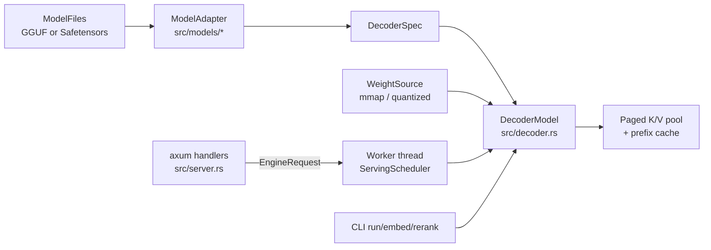

Every command goes through `LoadedRuntime::load`: open the files, choose an adapter, build the shared decoder from a `WeightSource`, then configure the paged K/V pool and the prefix cache. Blocking commands call the model directly. `serve` builds the same runtime inside one worker thread that owns the model for its whole life.

