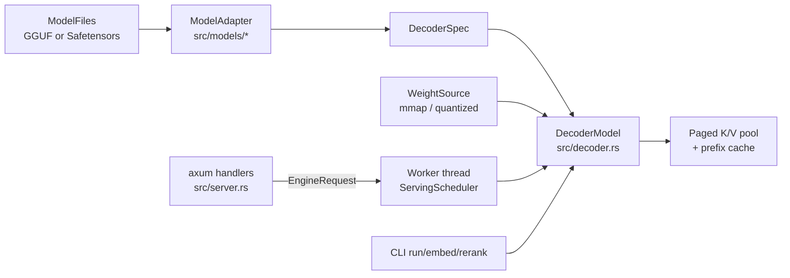

# How It Works

Every command goes through `LoadedRuntime::load`: open the files, choose an adapter, build the shared decoder from a `WeightSource`, then configure the paged K/V pool and the prefix cache. Blocking commands call the model directly. `serve` builds the same runtime inside one worker thread that owns the model for its whole life.

Sources: [lib.rs:1-7](../../src/lib.rs#L1-L7) · [runtime.rs:62-103](../../src/runtime.rs#L62-L103) · [engine.rs:773-805](../../src/engine.rs#L773-L805)

## Adapters and the shared decoder

`ModelAdapter` is the only place family code lives. An adapter turns a config or GGUF metadata into a `RuntimeSpec` and a `DecoderSpec`, maps weight names, and renders chat or agent prompts. Every adapter's `build_model` returns a `DecoderModel`, so attention, caching, batching and sampling are written once.

A `DecoderSpec` is a list of per-layer specs. Each layer picks a `SequenceMixerSpec`: `Attention` (full or sliding causal, RoPE or NoPE), `ShortConvolution` (LFM2), `GatedDeltaNet` (Qwen3.5) or `ParallelAttentionMamba2` (Falcon-H1), plus a dense or sparse-MoE feed-forward. Hybrid models are therefore just layer lists, and the decoder implements the `CausalLm` trait the rest of the runtime uses.

`ModelAdapter::build` checks that the built model's runtime metadata matches the adapter's, and `validate` checks that the spec is internally consistent before any weight is touched.

Sources: [mod.rs:28-56](../../src/models/mod.rs#L28-L56) · [mod.rs:102-118](../../src/models/mod.rs#L102-L118) · [architecture.rs:224-229](../../src/architecture.rs#L224-L229) · [architecture.rs:1038-1064](../../src/architecture.rs#L1038-L1064) · [gemma.rs:71-76](../../src/models/gemma.rs#L71-L76) · +4

## Loading weights without copying them

`ModelFiles::weight_source` memory-maps Safetensors through Candle's `VarBuilder`. GGUF goes through the project's own parser and an mmap-backed `GgufWeightSource`, and block-quantized matrices stay compressed through model build and run as `QMatMul`. With the `metal` feature, `file_backed_quant` wraps each GGUF shard's read-only mapping in one shared Metal buffer and binds each tensor at its file offset. Candle's stock loader would instead copy every weight into an anonymous buffer, turning the whole model into dirty unified memory.

Because of this, model files must not be modified while a model is loaded; the loader is `unsafe` for that reason. After loading, macOS is asked to return the pages freed by tokenizer and metadata construction (`malloc_zone_pressure_relief`).

Sources: [weights.rs:240-275](../../src/weights.rs#L240-L275) · [file_backed_quant.rs:1-6](../../src/file_backed_quant.rs#L1-L6) · [model_weights.rs:1-40](../../src/model_weights.rs#L1-L40) · [model_weights.rs:305-306](../../src/model_weights.rs#L305-L306) · [runtime.rs:113-128](../../src/runtime.rs#L113-L128)

## The serving scheduler

The runtime does not require models to be `Send`, so `EngineHandle::start` builds the model inside a thread named `macllm-inference` and never moves it. HTTP handlers send `InferenceJob`s over a bounded channel (`--queue-capacity`) and get back an `EngineTicket`, a request-local event stream. Dropping the ticket is how a client disconnect cancels a request.

The worker runs continuous batching in rounds. In each round it visits up to `--max-active-sequences` active sequences. Each sequence gets at most `--prefill-token-quantum` input tokens, and the round stops at `--scheduler-token-budget`. All visited lanes run as one packed ragged forward. Decode lanes cost one token, so long prompts are chunked and cannot starve running generations. A lane whose client stops draining events for `--event-send-timeout-seconds` is cancelled.

Any error or panic inside the loop poisons the worker (`/healthz` reports `poisoned`) instead of continuing with model state that may be inconsistent.

Sources: [runtime.rs:52-55](../../src/runtime.rs#L52-L55) · [engine.rs:773-822](../../src/engine.rs#L773-L822) · [engine.rs:1452-1522](../../src/engine.rs#L1452-L1522) · [engine.rs:1795-1822](../../src/engine.rs#L1795-L1822) · [engine.rs:1860-1945](../../src/engine.rs#L1860-L1945) · +2

## K/V cache layout

Each decoder layer gets a `KvCachePolicy`:

- `Paged`: full-attention layers share one model-wide pool. Its blocks are `--kv-cache-block-tokens` long, allocated `--kv-cache-slab-blocks` at a time, up to `--kv-cache-capacity-tokens` in total (by default one model context for all sequences together, not per sequence). Each sequence holds a `PagedKvBlockTable` of block IDs, and one block stores K and V for every full-attention layer.
- `Sliding`: local-attention layers keep a per-sequence ring of `2 * (W - 1)` slots. A rollback restores three integers instead of copying tensors.
- `Full`: a grow-on-demand contiguous cache.

Batch growth is transactional. A `PagedKvBatchReservation` reserves blocks for every lane before a forward, and dropping it without commit rolls all of them back. Blocks can be shared between tables by reference counting; appending to a shared partial tail block copies it first (copy-on-write).

Sources: [cache.rs:116-122](../../src/cache.rs#L116-L122) · [cache.rs:162-166](../../src/cache.rs#L162-L166) · [cache.rs:1401-1410](../../src/cache.rs#L1401-L1410) · [cache.rs:1450-1460](../../src/cache.rs#L1450-L1460) · [cache.rs:2392-2397](../../src/cache.rs#L2392-L2397) · +3

## Automatic prefix cache

`TokenPrefixCache` is a cost-bounded LRU of model-state snapshots keyed by exact token IDs. Hash blocks only narrow the candidates; every hit is confirmed by a token-by-token comparison from position zero. A snapshot is stored only at each inserted prompt endpoint, never at every block, so a set of progressively longer prompts does not retain a quadratic amount of state.

After prefill, `publish_prompt_prefix` stores the prompt. Attention-only models store it truncated to a block boundary as a forked block table, which shares pages by reference count. Before the next prompt, `reset_session_for_prompt` restores the longest match into the session and reports it as `cached_tokens`.

Recurrent layers (ShortConv, Gated DeltaNet, Mamba2) need exact-endpoint snapshots of their state, because recurrent state cannot be truncated. Sliding-window rings are mutable and cannot be forked, so `validate_prefix_cache_topology` rejects any sliding layer. The cache and sliding-window attention are therefore mutually exclusive, and a non-zero capacity on such a model is a load error, not a silent no-op. Benchmark waves can opt out of publishing through `EngineRequestPolicy`.

Sources: [prefix_cache.rs:1-7](../../src/prefix_cache.rs#L1-L7) · [prefix_cache.rs:116-122](../../src/prefix_cache.rs#L116-L122) · [decoder.rs:3461-3499](../../src/decoder.rs#L3461-L3499) · [decoder.rs:3501-3540](../../src/decoder.rs#L3501-L3540) · [decoder.rs:4308-4340](../../src/decoder.rs#L4308-L4340) · +2

## Custom Metal kernels are compiled at runtime

Most tensor operations come from Candle. The project adds three Metal sources in `src/metal/`: `paged_decode.metal` (paged attention that reads K/V through a block page table, including a batched GQA-4 variant), `gated_delta_decay.metal` (Gated DeltaNet) and `mamba2_scan.metal` (Mamba2 scan). Each is embedded with `include_str!` and compiled from source by `new_library_with_source` the first time a device needs it. The pipelines are cached per Metal device `registry_id`.

`build.rs` does not touch these kernels. It only embeds `MACLLM_BUILD_PROFILE`, `MACLLM_BUILD_OPT_LEVEL`, `MACLLM_BUILD_GIT_COMMIT` and `MACLLM_BUILD_GIT_DIRTY` for benchmark provenance. A kernel compile error therefore appears at run time, on first use, and benchmarks use `--warmup-runs` to keep that compile cost out of measurements.

The paged kernel is used only when its preflight passes: batch 1, at most 128 query tokens per lane and 128 lanes, head dimension at most 256, and F32 or F16. Otherwise it returns `None` and the decoder falls back to materialized attention.

Sources: [paged_attention.rs:790](../../src/paged_attention.rs#L790) · [paged_attention.rs:1195-1226](../../src/paged_attention.rs#L1195-L1226) · [paged_attention.rs:14-47](../../src/paged_attention.rs#L14-L47) · [mamba2.rs:331](../../src/mamba2.rs#L331) · [mamba2.rs:480-491](../../src/mamba2.rs#L480-L491) · +9
