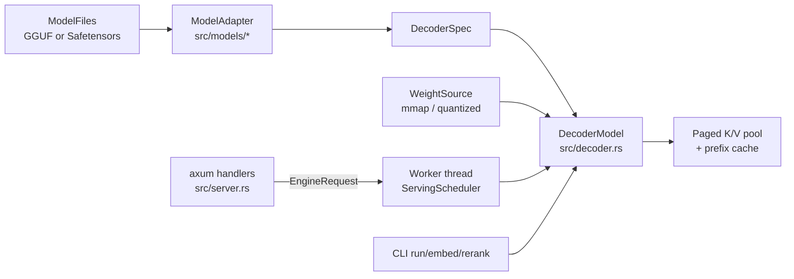
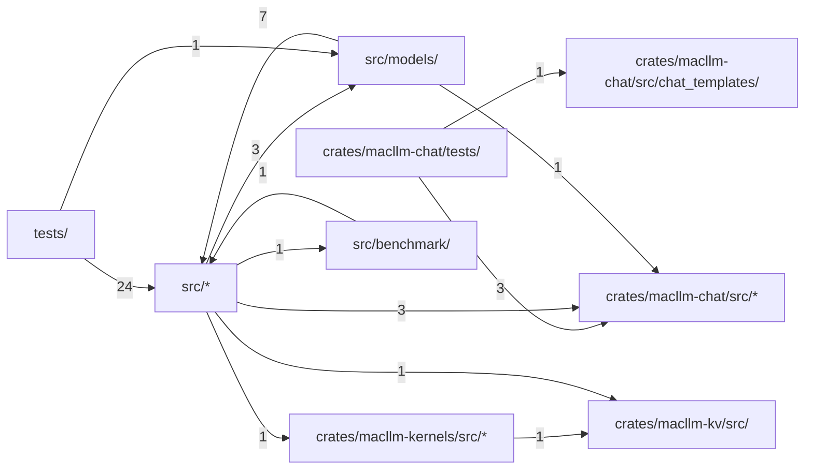

# macllm-infer

**English** · [中文](zh/all.md)

These docs go one level below the README of MacLLM Infer, a Rust, Apple
Silicon-first, text-only LLM runtime. They state what the code at this commit
actually supports (which formats and architectures, which CLI flags and HTTP
fields, which defaults), how a request flows from model loading through the
serving scheduler, paged K/V cache and prefix cache to the Metal kernels, and
how the pinned reference tests and benchmark manifests gate correctness and
performance claims. They describe current capabilities only.

## Overview and Support Matrix

MacLLM Infer is an Apple Silicon-first Rust workspace that runs text-only decoder LLMs through Candle. The main crate is `macllm-infer` (binary `macllm`); chat and tool-call handling, the K/V cache and the custom kernels live in the `macllm-chat`, `macllm-kv` and `macllm-kernels` crates. Metal and Accelerate are default features; the optional `cuda` feature adds NVIDIA GPUs through `--device cuda`. One shared decoder executes every supported family; family code is limited to thin adapters that translate a checkpoint's configuration, weight names and prompt template into a format-neutral spec. The same loaded model serves blocking CLI generation, Qwen3 embedding and reranking, and a long-lived HTTP worker. `llama.cpp` is used as the reference for GGUF parsing, greedy-token correctness and performance, never as a linked dependency.

This page states exactly what the code accepts. See [Command-Line Usage](#cli) for usage, [How It Works](#how-it-works) for the design, and [Code structure](#structure) for the module map.

Sources: [Cargo.toml:1-22](../../Cargo.toml#L1-L22) · [Cargo.toml:46-71](../../Cargo.toml#L46-L71) · [lib.rs:1-7](../../src/lib.rs#L1-L7) · [lib.rs:40-45](../../src/lib.rs#L40-L45) · [backend.rs:34-58](../../src/backend.rs#L34-L58) · +1

### Supported formats and architectures

`ModelFiles::from_dir` accepts a standalone `.gguf` file or a directory. A directory holding both GGUF and Safetensors weights is rejected, and so is a directory whose `macllm download` marker says the download did not complete. Otherwise GGUF wins discovery, and canonical GGUF shard sets are opened as one logical file.

The two formats do not cover the same architectures:

| Format | Dispatch key | Architectures |
| --- | --- | --- |
| GGUF v3 | `general.architecture` in `GgufModel::open` | `falcon-h1`, `gemma`, `gemma2`, `gemma3`, `granitemoe`, `lfm2`, `llama`, `qwen2`, `qwen3`, `qwen3moe`, `qwen35`, `smollm3` |
| Safetensors | `model_type` in `config.json` (`detect`) | `llama`, `lfm2`, `qwen2`, `qwen3` |

The 12-architecture list therefore applies to GGUF only. A Safetensors directory also needs `config.json` and `tokenizer.json`; GGUF uses its embedded tokenizer. GGUF tensor types accepted by `GgufTensorType` are F32, F16, BF16, Q4_0, Q5_0, Q5_1, Q8_0 and Q2_K through Q6_K.

Sources: [weights.rs:58-115](../../src/weights.rs#L58-L115) · [snapshot.rs:83-96](../../src/snapshot.rs#L83-L96) · [mod.rs:698-714](../../src/models/mod.rs#L698-L714) · [gguf_model.rs:316-335](../../src/gguf_model.rs#L316-L335) · [gguf.rs:283-297](../../src/gguf.rs#L283-L297)

### Current limits at a glance

Support is checkpoint-specific and fails closed. The boundaries a new user hits first:

- Embedding and reranking accept only Safetensors Qwen3 task checkpoints (`validate_task_checkpoint`) and exist only as the `embed`/`rerank` CLI commands; the HTTP router has no embedding or rerank route. See [Command-Line Usage](#cli).
- The server exposes `/healthz`, `/v1/models`, `/v1/chat/completions` and a benchmark `/completion` route. Which tool calls a model can make depends on its chat template. See [HTTP Server and API Subset](#http-api).
- The automatic prefix cache and sliding-window attention layers are mutually exclusive: enabling the cache on a model with a sliding layer fails at load. See [How It Works](#how-it-works).
- The CPU backend requires `--dtype f32`.
- Correctness claims come from pinned per-checkpoint reference tests, for example Gemma 1 2B Q2_K and SmolLM3-3B Q4_K_M. See [Benchmarks, Gates and Contributing](#benchmarks-and-testing).

Sources: [main.rs:1010-1023](../../src/main.rs#L1010-L1023) · [server.rs:224-228](../../src/server.rs#L224-L228) · [decoder.rs:4331-4352](../../src/decoder.rs#L4331-L4352) · [backend.rs:61-71](../../src/backend.rs#L61-L71)

## Command-Line Usage

The `macllm` binary has nine subcommands: `download`, `inspect`, `run`, `embed`, `rerank`, `bench`, `scoreboard`, `demo` and `serve`. All flags below are copied from the clap definitions in `src/main.rs`. There are no runtime environment variables; the `MACLLM_*` variables in the code only point the ignored reference tests at fixture files (see [Benchmarks, Gates and Contributing](#benchmarks-and-testing)). `serve` is covered in [HTTP Server and API Subset](#http-api); `bench`, `scoreboard` and `demo` in [Benchmarks, Gates and Contributing](#benchmarks-and-testing).

Sources: [main.rs:62-96](../../src/main.rs#L62-L96)

### Model, device and K/V flags

Every model-loading command shares `RuntimeArgs`:

| Flag | Default | Meaning |
| --- | --- | --- |
| `-m, --model` | required | `.gguf` file or model directory |
| `--device` | `metal` | `metal`, `cuda` or `cpu`; builds without Metal default to `cuda` if built with it, else `cpu` |
| `--dtype` | see below | `f32`, `f16`, `bf16` activations |
| `--kv-cache-block-tokens` | `16` | tokens per logical K/V block |
| `--kv-cache-slab-blocks` | `8` | blocks per physical slab allocation |
| `--kv-cache-capacity-tokens` | one model context | total K/V tokens shared by all sequences, rounded up to a block |
| `--prefill-attention` | `sdpa` | multi-row prefill chunks use Candle's fused SDPA kernel; `native` keeps the paged Metal kernel with its dense fallback |

`resolve_dtype` picks `f32` on CPU or when the GGUF has quantized tensors, `f16` otherwise. The CPU/Accelerate backend rejects anything but `f32`; Metal and CUDA accept all three.

Sources: [main.rs:36-48](../../src/main.rs#L36-L48) · [main.rs:114-150](../../src/main.rs#L114-L150) · [runtime.rs:37-40](../../src/runtime.rs#L37-L40) · [runtime.rs:167-180](../../src/runtime.rs#L167-L180) · [backend.rs:61-71](../../src/backend.rs#L61-L71)

### Generating text with run

`run` renders `--prompt` (plus optional `--system`) through the adapter's chat template, tokenizes it, and streams decoded text to stdout. Adapters render the templates they pin byte-for-byte; an unpinned template embedded in a GGUF file goes through the generic Jinja renderer, and a checkpoint with neither fails. `--raw-prompt` bypasses the template and tokenizes the prompt verbatim. `--add-special-tokens` asks the tokenizer to add BOS/EOS; leave it off for templates that already contain BOS.

Sampling defaults: `--max-new-tokens 128`, `--temperature 0.7` (0 means greedy argmax), `--top-k 20`, `--top-p 0.8`, `--repetition-penalty 1.1`, `--seed 42`.

`--prefill-token-quantum` caps prompt tokens per prefill forward. Unset, Metal uses 128 unless `--dtype bf16`; CPU, CUDA and BF16 prefill in one shot. After generation, a metrics line on stderr reports prompt, cached and processed tokens, TTFT, prefill and decode tokens per second.

Sources: [main.rs:152-190](../../src/main.rs#L152-L190) · [main.rs:1320-1334](../../src/main.rs#L1320-L1334) · [main.rs:1345-1356](../../src/main.rs#L1345-L1356) · [mod.rs:515-536](../../src/models/mod.rs#L515-L536) · [gguf_model.rs:365-387](../../src/gguf_model.rs#L365-L387) · +1

### Embedding and reranking

`embed` and `rerank` work only with Safetensors Qwen3 task checkpoints. `Qwen3EmbeddingProfile` and `Qwen3RerankerProfile` check the sentence-transformers files (`modules.json`, `config_sentence_transformers.json`, and the pooling or logit-score module config), the EOS token, last-token pooling or distinct yes/no label IDs; `validate_task_checkpoint` then requires the Safetensors format. These tasks are CLI-only.

- `embed --input-type query|document --input TEXT [--input TEXT ...] [--instruction TEXT]`; `--instruction` is valid only for queries.
- `rerank --query TEXT --document TEXT [--document TEXT ...] [--instruction TEXT]`.

Inputs longer than `min(max_position_embeddings, 8192)` tokens are rejected, not truncated. Output is pretty-printed JSON on stdout, ordered by input `index` and without echoing inputs. Embedding rows carry a unit-length `embedding`; rerank rows carry `margin` (`yes_logit - no_logit`) and `yes_probability` (its sigmoid).

Sources: [main.rs:216-276](../../src/main.rs#L216-L276) · [main.rs:908-950](../../src/main.rs#L908-L950) · [main.rs:965-1023](../../src/main.rs#L965-L1023) · [main.rs:1025-1068](../../src/main.rs#L1025-L1068) · [qwen3_tasks.rs:1-40](../../src/models/qwen3_tasks.rs#L1-L40) · +5

### Downloading and inspecting checkpoints

`download [REPO]` (default `Qwen/Qwen2.5-0.5B-Instruct`, output `-o models/qwen2.5-0.5b-instruct`, optional `--revision`) fetches a fixed Safetensors allow-list: config, generation and tokenizer JSON, `model*.safetensors` plus index, and the sentence-transformers sidecars. `--gguf FILENAME` instead fetches one root-level GGUF, or every shard when given the canonical first shard. Files land in a temporary staging directory, must pass `ModelFiles::from_dir`, and only then replace the destination. A `.macllm-revision` marker records the resolved commit and whether the download completed; a model directory whose marker says incomplete is refused at load.

`inspect -m PATH` parses metadata without loading weights and prints family, layer geometry, F16 K/V bytes per token, fixed recurrent state per sequence, maximum context, vocabulary, stop token IDs, format and GGUF tensor-type counts.

Sources: [main.rs:64-76](../../src/main.rs#L64-L76) · [hub.rs:14-47](../../src/hub.rs#L14-L47) · [hub.rs:59-109](../../src/hub.rs#L59-L109) · [snapshot.rs:60-96](../../src/snapshot.rs#L60-L96) · [main.rs:810-857](../../src/main.rs#L810-L857)

## HTTP Server and API Subset

`macllm serve` loads one model on a dedicated worker thread and serves it over HTTP/1 with axum until Ctrl-C. It binds to loopback by default and has no authentication or TLS of its own; embedding and reranking stay CLI-only.

| Flag | Default | Meaning |
| --- | --- | --- |
| `--host` / `--port` | `127.0.0.1` / `8080` | bind address |
| `--served-model-name` | model path's file name | ID clients send as `model` |
| `--queue-capacity` | `8` | requests waiting for an active slot |
| `--max-active-sequences` | `2` | sequences rotated on the worker |
| `--scheduler-token-budget` | `256` | model-input tokens per scheduler round |
| `--prefill-token-quantum` | `128` | prompt tokens per sequence per turn |
| `--event-capacity` | `16` | per-request event channel size |
| `--event-send-timeout-seconds` | `30` | cancel a request whose client stops reading |
| `--prefix-cache-capacity-tokens` | `32768` | prefix-cache budget; `0` disables it |
| `--default-max-completion-tokens` | `128` | budget of chat requests that set none; must fit the model context |
| `--disable-thinking` | off | `enable_thinking=false` unless a request sets it; the template must use the option |
| `--sampling-profile` | `openai` | omitted sampling fields: `openai` (1.0 / 1.0, no top-k), or `qwen3` / `qwen35` model-card values per thinking mode |
| `--reasoning-format` | `deepseek` | return thinking as `reasoning_content`; `none` keeps it in the answer |

The shared model flags (`--model`, `--device`, `--dtype`, `--kv-cache-*`) apply as in [Command-Line Usage](#cli).

Sources: [main.rs:440-491](../../src/main.rs#L440-L491) · [main.rs:1357-1392](../../src/main.rs#L1357-L1392) · [server.rs:142-170](../../src/server.rs#L142-L170) · [server.rs:232-262](../../src/server.rs#L232-L262)

### Endpoints

| Route | Purpose |
| --- | --- |
| `GET /healthz` | `status`, `worker` (`starting`, `ready`, `busy`, `poisoned`, `stopped`), `model`, `device` (the live backend: `metal`, `cuda` or `cpu`), `dtype`; 503 when unhealthy |
| `GET /v1/models` | the single served model |
| `POST /v1/chat/completions` | strict Chat Completions subset, JSON or SSE |
| `POST /completion` | untemplated, llama-server-shaped route used by the benchmarks |

`/completion` requires every field of `RawCompletionRequest` (`prompt`, `n_predict`, `temperature`, `top_k`, `top_p`, `seed`, `cache_prompt`, `stream`, `return_tokens`, `id_slot`, `ignore_eos`, `repeat_penalty`, `response_fields`) and rejects unknown ones, so both servers in a benchmark get an identical contract.

A full queue returns 429; a stopped or poisoned worker returns 503. Streams send a keep-alive comment every 15 seconds and end with `data: [DONE]`.

Sources: [server.rs:224-228](../../src/server.rs#L224-L228) · [server.rs:264-299](../../src/server.rs#L264-L299) · [engine.rs:1287-1292](../../src/engine.rs#L1287-L1292) · [backend.rs:74-88](../../src/backend.rs#L74-L88) · [server.rs:327-344](../../src/server.rs#L327-L344) · +3

### What /v1/chat/completions accepts

Unknown JSON fields are a 400, and known-but-unsupported fields return an OpenAI-shaped error instead of being dropped.

- `model` must equal the served model name; `n` must be 1.
- `max_completion_tokens` (or the deprecated `max_tokens`, never both) defaults to `--default-max-completion-tokens` and may not exceed the model context.
- `temperature` in [0, 2] and `top_p` in (0, 1] default to the `--sampling-profile` values, which also fix `top_k`; `presence_penalty` and `frequency_penalty` take [-2, 2]; `seed` must be non-negative. Repetition penalty is fixed to 1.0.
- `stop` takes a string or up to 4 strings.
- `stream` with `stream_options.include_usage`; `include_obfuscation=true` is rejected.
- `chat_template_kwargs` accepts only a boolean `enable_thinking`.
- Roles: `system`, `user`, `assistant`, and `tool` in tool-call histories (string content and a `tool_call_id` answering a call of the preceding assistant turn). That turn holds exactly one call, or several on generic templates with a detected tool-call format. Assistant `reasoning_content` is accepted only by the Qwen3, Qwen3MoE and Qwen3.5 templates. `function`, `developer`, `name`, multimodal content, `logprobs` and `top_logprobs` are rejected.

`usage.prompt_tokens_details.cached_tokens` reports how many prompt tokens came from the prefix cache.

Sources: [openai.rs:54-108](../../crates/macllm-chat/src/openai.rs#L54-L108) · [openai.rs:136-230](../../crates/macllm-chat/src/openai.rs#L136-L230) · [openai.rs:600-630](../../crates/macllm-chat/src/openai.rs#L600-L630) · [output.rs:4](../../crates/macllm-chat/src/output.rs#L4) · [openai.rs:937-1035](../../crates/macllm-chat/src/openai.rs#L937-L1035) · +6

### Structured output and tool calls

The constraint grammar in `crates/macllm-chat/src/grammar.rs` checks each candidate token's decoded bytes against a closed JSON Schema subset. Unknown schema keywords are rejected, and object schemas need `additionalProperties: false`.

- `response_format` takes only `{"type":"json_schema","json_schema":{...,"strict":true}}`. It cannot be combined with `stop`, tools or tool-call history.
- Tools: up to 128 uniquely named functions. With tools, `tool_choice` defaults to `auto`; `none`, a named function, or `"required"` with exactly one tool are also accepted. `stop` is not allowed while tools are enabled.
- `auto` on a pinned Qwen3, Qwen3MoE or Qwen3.5 template: the answer may end in one call, constrained by a lazy grammar. On a generic GGUF template, the call format is detected from the template (Hermes, Qwen XML, Llama 3 JSON, Mistral JSON, Granite JSON, Pythonic); every parsed call is checked against its declaration; only the first is returned unless `parallel_tool_calls` allows more.
- Forced calls need `parallel_tool_calls=false` and generate the arguments under the schema. They work on pinned Qwen3/Qwen3MoE profiles and generic Hermes templates; Qwen3.5 refuses them, as does a generic template whose prompt opens a reasoning block.
- Other adapters fail closed in `format_agent_prompt`.

Sources: [grammar.rs:1-20](../../crates/macllm-chat/src/grammar.rs#L1-L20) · [openai.rs:232-247](../../crates/macllm-chat/src/openai.rs#L232-L247) · [openai.rs:632-650](../../crates/macllm-chat/src/openai.rs#L632-L650) · [openai.rs:652-689](../../crates/macllm-chat/src/openai.rs#L652-L689) · [openai.rs:691-795](../../crates/macllm-chat/src/openai.rs#L691-L795) · +13

### Startup checks and the prefix-cache flag

`EngineHandle::start` returns only after the worker has loaded the model, so `serve` fails before binding if any check fails:

1. The model must support packed ragged batches.
2. The adapter must render a health-check chat prompt through its pinned or generic template, and that prompt must tokenize to at least one token. Checkpoints without a usable template can be used with `run --raw-prompt` but not served.
3. A server-wide `--disable-thinking` must be honoured by the template.
4. All `--max-active-sequences` sessions are created up front.

`serve` then checks that `--default-max-completion-tokens` fits the model context.

`serve` enables the automatic prefix cache by default (32768 tokens), and the cache cannot coexist with sliding-window attention ([How It Works](#how-it-works)). A model with any `SlidingCausal` layer therefore fails to load with "sliding-attention storage is mutable". Gemma 2 and Gemma 3 normally interleave such layers, and GGUF Llama gets them when `llama.attention.sliding_window` is non-zero. Serve those models with `--prefix-cache-capacity-tokens 0`.

Sources: [engine.rs:863-867](../../src/engine.rs#L863-L867) · [engine.rs:1224-1239](../../src/engine.rs#L1224-L1239) · [engine.rs:1269-1360](../../src/engine.rs#L1269-L1360) · [mod.rs:115-117](../../src/models/mod.rs#L115-L117) · [server.rs:233-240](../../src/server.rs#L233-L240) · +6

## How It Works

Every command goes through `LoadedRuntime::load`: open the files, choose an adapter, build the shared decoder from a `WeightSource`, then configure the paged K/V pool, the prefix cache and the prefill attention mode. Blocking commands call the model directly. `serve` builds the same runtime inside one worker thread that owns the model for its whole life.

Sources: [lib.rs:1-7](../../src/lib.rs#L1-L7) · [runtime.rs:66-103](../../src/runtime.rs#L66-L103) · [engine.rs:849-862](../../src/engine.rs#L849-L862)

### Adapters and the shared decoder

`ModelAdapter` is the only place family code lives. An adapter turns a config or GGUF metadata into a `RuntimeSpec` and a `DecoderSpec`, maps weight names, and renders chat or agent prompts. Unpinned GGUF templates go to a generic Jinja renderer (`attach_prompt_tokens` in the Qwen adapters, `with_jinja_fallback` for the rest). Every adapter's `build_model` returns a `DecoderModel`, so attention, caching, batching and sampling are written once.

A `DecoderSpec` is a list of per-layer specs. Each layer picks a `SequenceMixerSpec`: `Attention` (full or sliding causal, RoPE or NoPE), `ShortConvolution` (LFM2), `GatedDeltaNet` (Qwen3.5) or `ParallelAttentionMamba2` (Falcon-H1), plus a dense or sparse-MoE feed-forward. Hybrid models are just layer lists; the decoder implements the `CausalLm` trait the rest of the runtime uses.

`ModelAdapter::build` checks the built model's runtime metadata against the adapter's, and `validate` checks the spec's consistency before any weight is touched.

Sources: [mod.rs:35-66](../../src/models/mod.rs#L35-L66) · [mod.rs:128-155](../../src/models/mod.rs#L128-L155) · [mod.rs:609-627](../../src/models/mod.rs#L609-L627) · [gguf_model.rs:365-387](../../src/gguf_model.rs#L365-L387) · [mod.rs:698-714](../../src/models/mod.rs#L698-L714) · +7

### Loading weights without copying them

`ModelFiles::weight_source` memory-maps Safetensors through Candle's `VarBuilder`. GGUF goes through the project's own parser and an mmap-backed `GgufWeightSource`, and block-quantized matrices stay compressed through model build and run as `QMatMul`. With the `metal` feature, `file_backed_quant` wraps each GGUF shard's read-only mapping in one shared Metal buffer and binds each tensor at its file offset. Candle's stock loader would copy every weight into an anonymous buffer, making the model dirty unified memory.

Model files must therefore stay unmodified and untruncated while a model built from them is alive (the loader is `unsafe`); GGUF keeps its opened handle, so replacing its path after parsing is safe. After loading, macOS is asked to return the pages freed by tokenizer and metadata construction (`malloc_zone_pressure_relief`).

Sources: [weights.rs:240-275](../../src/weights.rs#L240-L275) · [file_backed_quant.rs:1-6](../../src/file_backed_quant.rs#L1-L6) · [model_weights.rs:1-40](../../src/model_weights.rs#L1-L40) · [model_weights.rs:305-306](../../src/model_weights.rs#L305-L306) · [runtime.rs:118-133](../../src/runtime.rs#L118-L133)

### The serving scheduler

Models need not be `Send`: `EngineHandle::start` builds the model inside the `macllm-inference` thread and never moves it. HTTP handlers send `InferenceJob`s over a bounded channel (`--queue-capacity`) and get back an `EngineTicket`, a request-local event stream. Dropping the ticket cancels the request.

The worker runs continuous batching in rounds. In each round it visits up to `--max-active-sequences` active sequences. Each sequence gets at most `--prefill-token-quantum` input tokens, and the round stops at `--scheduler-token-budget`. All visited lanes run as one packed ragged forward. Decode lanes cost one token, so long prompts cannot starve running generations. A lane whose client stops draining events for `--event-send-timeout-seconds` is cancelled.

A panic, or an error escaping admission or the shared `drive_once` step (a failed forward), poisons the worker (`/healthz` reports `poisoned`) and fails active and queued requests. Request-local failures (invalid sampling, one lane's KV-cache exhaustion, incomplete JSON-schema output) fail only that request.

Sources: [runtime.rs:56-59](../../src/runtime.rs#L56-L59) · [engine.rs:829-869](../../src/engine.rs#L829-L869) · [engine.rs:1578-1648](../../src/engine.rs#L1578-L1648) · [engine.rs:1938-1965](../../src/engine.rs#L1938-L1965) · [engine.rs:2003-2088](../../src/engine.rs#L2003-L2088) · +6

### K/V cache layout

Each decoder layer gets a `KvCachePolicy`:

- `Paged`: full-attention layers share one model-wide pool. Its blocks are `--kv-cache-block-tokens` long, allocated `--kv-cache-slab-blocks` at a time, up to `--kv-cache-capacity-tokens` in total (by default one model context for all sequences together, not per sequence). Each sequence holds a `PagedKvBlockTable` of block IDs, and one block stores K and V for every full-attention layer.
- `Sliding`: local-attention layers keep a per-sequence ring of `2 * (W - 1)` slots. A rollback restores three integers instead of copying tensors.
- `Full`: a grow-on-demand contiguous cache.

Batch growth is transactional. A `PagedKvBatchReservation` reserves blocks for every lane before a forward, and dropping it without commit rolls all of them back. Blocks can be shared between tables by reference counting; appending to a shared partial tail block copies it first (copy-on-write).

Sources: [cache.rs:119-125](../../crates/macllm-kv/src/cache.rs#L119-L125) · [cache.rs:165-169](../../crates/macllm-kv/src/cache.rs#L165-L169) · [cache.rs:1432-1441](../../crates/macllm-kv/src/cache.rs#L1432-L1441) · [cache.rs:1481-1491](../../crates/macllm-kv/src/cache.rs#L1481-L1491) · [cache.rs:2423-2428](../../crates/macllm-kv/src/cache.rs#L2423-L2428) · +3

### Automatic prefix cache

`TokenPrefixCache` is a cost-bounded LRU of model-state snapshots keyed by exact token IDs. Hash blocks only narrow the candidates; every hit is confirmed by a token-by-token comparison from position zero. A snapshot is stored only at each inserted prompt endpoint, never at every block, so a set of progressively longer prompts does not retain a quadratic amount of state.

After prefill, `publish_prompt_prefix` stores the prompt. Attention-only models store it truncated to a block boundary as a forked block table, which shares pages by reference count. Before the next prompt, `reset_session_for_prompt` restores the longest match into the session and reports it as `cached_tokens`.

Recurrent layers (ShortConv, Gated DeltaNet, Mamba2) need exact-endpoint snapshots of their state, because recurrent state cannot be truncated. Sliding-window rings are mutable and cannot be forked, so `validate_prefix_cache_topology` rejects any sliding layer. The cache and sliding-window attention are therefore mutually exclusive, and a non-zero capacity on such a model is a load error, not a silent no-op. Benchmark waves can opt out of publishing through `EngineRequestPolicy`.

Sources: [prefix_cache.rs:1-7](../../crates/macllm-kv/src/prefix_cache.rs#L1-L7) · [prefix_cache.rs:116-122](../../crates/macllm-kv/src/prefix_cache.rs#L116-L122) · [decoder.rs:3473-3511](../../src/decoder.rs#L3473-L3511) · [decoder.rs:3513-3552](../../src/decoder.rs#L3513-L3552) · [decoder.rs:4320-4352](../../src/decoder.rs#L4320-L4352) · +2

### Custom Metal kernels are compiled at runtime

Beyond Candle's operations, `macllm-kernels` adds three Metal sources in `crates/macllm-kernels/src/metal/`: `paged_decode.metal` (paged attention that reads K/V through a block page table, including a batched GQA-4 variant), `gated_delta_decay.metal` (Gated DeltaNet) and `mamba2_scan.metal` (Mamba2 scan). Each is embedded with `include_str!` and compiled from source by `new_library_with_source` the first time a device needs it. The pipelines are cached per Metal device `registry_id`.

`build.rs` never touches the kernels; it only embeds build and Git provenance for benchmarks. A kernel compile error therefore appears on first use, and benchmarks use `--warmup-runs` to keep the compile cost out of measurements.

The paged kernel is used only when its preflight passes: batch 1, at most 128 query tokens per lane and 128 lanes, head dimension at most 256, F32 or F16, and a Metal device with Tier 2 argument buffers. Otherwise it returns `None` and the decoder falls back to materialized attention.

Sources: [paged_attention.rs:800](../../crates/macllm-kernels/src/paged_attention.rs#L800) · [paged_attention.rs:1205-1236](../../crates/macllm-kernels/src/paged_attention.rs#L1205-L1236) · [paged_attention.rs:5-55](../../crates/macllm-kernels/src/paged_attention.rs#L5-L55) · [paged_attention.rs:892-896](../../crates/macllm-kernels/src/paged_attention.rs#L892-L896) · [mamba2.rs:332](../../crates/macllm-kernels/src/mamba2.rs#L332) · +10

## Benchmarks, Gates and Contributing

Claims in this project rest on two kinds of evidence. Checkpoint-pinned reference tests prove token-level correctness against `llama.cpp` or Candle. Manifest-pinned benchmarks under `macllm scoreboard`, `macllm demo` and `macllm bench` measure performance. Every measurement command refuses to run in an unoptimized build (`ensure_optimized_measurement_execution`), so use `--release`.

Sources: [mod.rs:1](../../src/benchmark/mod.rs#L1) · [gemma_gguf_reference.rs:1-8](../../tests/gemma_gguf_reference.rs#L1-L8) · [main.rs:763-808](../../src/main.rs#L763-L808)

### Pinned reference gates

Real-model tests are `#[ignore]`d and need their fixture files. The Gemma 1 gate is typical. It pins the public file by size and SHA-256 and checks the prompt token IDs. On CPU and on Metal, it asserts that cached decode matches a fresh full forward (same argmax, maximum-difference and relative-RMS logit bounds) and that greedy generation reproduces `llama.cpp`'s token IDs. Other gates compare against `llama.cpp` goldens, Candle's independent implementations, or both.

| Architecture | Pinned fixture |
| --- | --- |
| `gemma` | Gemma 1 2B-it Q2_K (`tensorblock/gemma-2b-it-GGUF`) |
| `gemma2` / `gemma3` | Gemma 2 2B-it Q4_K_M / Gemma 3 270M-it QAT Q4_0 |
| `smollm3` | SmolLM3-3B Q4_K_M (official) |
| `llama` | SmolLM2-135M, Llama 3.2 1B Q4_K_M, TinyLlama Q2_K and Q3_K_M, TinyMistral-6x248M MoE |
| `qwen2` / `qwen3` / `qwen35` | Qwen2.5-0.5B Q4_0 / Qwen3-0.6B Q8_0 (also as 12 shards) and Qwen3-4B Q4_K_M / Qwen3.5-0.8B Q4_0 |
| `qwen3moe` / `granitemoe` | loggenix-moe Q8_0 / Granite 3.1 1B-A400M Q4_K_M |
| `lfm2` / `falcon-h1` | LFM2-350M Q4_K_M / Falcon-H1-Tiny-90M Q8_0 |
| tasks | Qwen3 Embedding and Reranker checkpoints vs Candle and Qwen's examples |

Run one with its fixture variable, for example `MACLLM_GEMMA_GGUF_MODEL=models/gemma-2b-it-q2_k cargo test --release --test gemma_gguf_reference -- --ignored --nocapture`.

Sources: [gemma_gguf_reference.rs:1-8](../../tests/gemma_gguf_reference.rs#L1-L8) · [gemma_gguf_reference.rs:27-54](../../tests/gemma_gguf_reference.rs#L27-L54) · [gemma_gguf_reference.rs:148-201](../../tests/gemma_gguf_reference.rs#L148-L201) · [gemma_gguf_reference.rs:290-312](../../tests/gemma_gguf_reference.rs#L290-L312) · [smollm3_gguf_reference.rs:1-8](../../tests/smollm3_gguf_reference.rs#L1-L8) · +17

### Scoreboard manifests

A scoreboard manifest (`schema_version` 1, see `benchmarks/manifests/`) pins six things: `host` (machine model, chip, memory, CPU architecture); `model` (path relative to the manifest, Hugging Face repository, revision, filename, size, SHA-256, architecture, quantization); `llama_cpp` (binary directory, build number, commit, GPU layers, flash attention, K/V cache types, mmap); `workload` (prompt file with its SHA-256, token count and token-ID SHA-256, decode steps, greedy sampling, concurrency widths 1/4/8, warmups, samples, prefix-cache mode); and `runtime` (device, dtype, prefill quantum, K/V settings).

`scoreboard verify --manifest PATH` loads no weights. It checks the host, the model bytes, the detected architecture, a single GGUF file, the prompt token IDs, and the commit of the `llama-server`/`llama-bench` binaries, then prints a JSON summary. Any mismatch fails. The measuring subcommands run `verify` first: `macllm-kernel`, `llama-bench`, `llama-server` (`--port`, default 18081), `macllm-serving`, and `report`, which runs every stage and writes `--json` and `--markdown`.

Sources: [main.rs:348-394](../../src/main.rs#L348-L394) · [runner.rs:72-175](../../src/benchmark/runner.rs#L72-L175) · [smollm3-3b-q4_k_m-m4pro.json](../../benchmarks/manifests/smollm3-3b-q4_k_m-m4pro.json) · [main.rs:716-761](../../src/main.rs#L716-L761)

### Prefix-cache demos and local bench

`demo prefix-cache` and `demo fair-prefix` turn a repository's `Cargo.toml` and `src/**/*.rs` (`--repository`, default `.`) into an exact 16K-token shared prefix and send it as eight concurrent requests to both runtimes. They default to ports 18085 and 18086 and write `prefix-cache-demo.{json,md}` or `fair-prefix-benchmark.{json,md}`. Results are point estimates for that host and run.

`fair-prefix` also requires the same HTTP transport and F32 K/V precision on both sides. `main.rs` passes `MAC_PREFIX_DEMO_DEFAULT_MEASURED_WAVES` (20) as its measured waves per implementation. `validate_inputs` requires at least 20 waves, a count that splits evenly across 4 counterbalanced process lifetimes, and a manifest `fair_prefix` block that matches exactly. That block must declare 5 warm-up waves per lifetime (`FAIR_WARMUP_WAVES_PER_LIFETIME`), 32-token completions, a warm prefix cache, and `samples_per_concurrency` equal to waves times 8 (160). A 3-wave steady-state window (`FAIR_STEADY_STATE_WINDOW_WAVES`) checks the warm-ups.

`bench generate|embed|rerank` is a local diagnostic without a manifest: `--runs` (default 20) measured repetitions after `--warmup-runs` (default 1), greedy decoding, and rejection of any run whose output drifts. `scripts/bench-llama-cpp.sh MODEL.gguf` runs plain `llama-bench` and reads `PROMPT_TOKENS` (512), `OUTPUT_TOKENS` (128) and `RUNS` (3).

Sources: [main.rs:396-438](../../src/main.rs#L396-L438) · [main.rs:660-673](../../src/main.rs#L660-L673) · [prefix_demo_mac.rs:39-46](../../src/benchmark/prefix_demo_mac.rs#L39-L46) · [fair_prefix.rs:59-61](../../src/benchmark/fair_prefix.rs#L59-L61) · [fair_prefix.rs:912-956](../../src/benchmark/fair_prefix.rs#L912-L956) · +5

### Adding a model family

A new family touches only its adapter and a dispatch arm. The adapter boundary is explained in [How It Works](#how-it-works), and format dispatch in [Overview and Support Matrix](#overview).

1. Add `src/models/<family>.rs` implementing `ModelAdapter`: `family`, `runtime_spec`, `decoder_spec`, `build_model` (normally `DecoderModel::load`, or `load_with_weight_names` for non-standard tensor names) and `format_chat_messages`.
2. For GGUF, add a `<family>_spec` builder with an explicit list of accepted metadata keys, plus match arms in `GgufModel::open` and `GgufModel::architecture_adapter`. For Safetensors, add a `model_type` arm in `detect`.
3. Pin known chat templates by exact identity: the Qwen3 classifier in `crates/macllm-chat/src/chat_templates/` matches only byte length and SHA-256. An unpinned GGUF template falls back to the generic Jinja renderer ([How It Works](#how-it-works)). Implement `agent_template_profile` only once a native tool template is verified.
4. Add an ignored gate under `tests/` that pins a public fixture by SHA-256 and compares greedy tokens with `llama.cpp`.

If a new layer type needs its own mixer, extend `SequenceMixerSpec` and the decoder, and say whether the prefix cache can snapshot it.

Sources: [gguf_model.rs:64-83](../../src/gguf_model.rs#L64-L83) · [gguf_model.rs:391-435](../../src/gguf_model.rs#L391-L435) · [qwen3.rs:42-67](../../crates/macllm-chat/src/chat_templates/qwen3.rs#L42-L67) · [mod.rs:76-80](../../src/models/mod.rs#L76-L80) · [qwen3.rs:223-228](../../src/models/qwen3.rs#L223-L228) · +2

## Code structure

Generated by Codocia from the code on every build: areas, each area's own description, import dependencies between areas, and the pages that explain them.

In scope: 120 files, 119,405 lines; excluded `tests/fixtures/**`, `Cargo.lock`, `LICENSE-MIT`, `README_CN.md`, `.gitignore`

### Files

**Repository root**

- (root files) — 379 lines, 5 files. An Apple Silicon-first Rust LLM inference runtime\
  Hub files: `build.rs`\
  Explained in: [Overview and Support Matrix](#overview) (1), [How It Works](#how-it-works) (1)
- `benchmarks/` — 144 lines, 3 files\
  Explained in: [Benchmarks, Gates and Contributing](#benchmarks-and-testing) (2)
- `scripts/` — 25 lines, 1 file\
  Hub files: `bench-llama-cpp.sh`\
  Explained in: [Benchmarks, Gates and Contributing](#benchmarks-and-testing) (1)
- `tests/` — 10,485 lines, 26 files\
  Explained in: [Benchmarks, Gates and Contributing](#benchmarks-and-testing) (2)

**`crates/macllm-chat/`**

- (files) — 42 lines, 1 file. Protocol-independent chat, tool-call and constrained-output contracts for MacLLM Infer\
  Explained in: not covered
- `tests/` — 301 lines, 1 file\
  Explained in: not covered

**`crates/macllm-chat/src/`**

- (files) — 13,756 lines, 11 files. Protocol-independent chat contracts for `MacLLM Infer`.\
  Hub files: `tool_format.rs` `chat.rs` `lib.rs`\
  Explained in: [HTTP Server and API Subset](#http-api) (2), [Benchmarks, Gates and Contributing](#benchmarks-and-testing) (1)
- `chat_templates/` — 597 lines, 3 files. Byte-exact chat and agent prompt renderers for the pinned model families.\
  Hub files: `mod.rs` `qwen3.rs` `qwen35.rs`\
  Explained in: [Benchmarks, Gates and Contributing](#benchmarks-and-testing) (1)

**`crates/macllm-kernels/`**

- (files) — 49 lines, 1 file. Paged-attention, gated-delta and Mamba2 kernels for MacLLM Infer\
  Explained in: not covered

**`crates/macllm-kernels/src/`**

- (files) — 4,284 lines, 4 files. Custom Candle kernels for `MacLLM Infer`.\
  Hub files: `lib.rs` `paged_attention.rs` `gated_delta.rs`\
  Explained in: [How It Works](#how-it-works) (1)
- `metal/` — 652 lines, 3 files\
  Explained in: [How It Works](#how-it-works) (1)

**`crates/macllm-kv/`**

- (files) — 42 lines, 1 file. Paged K/V cache and request-prefix index for MacLLM Infer\
  Explained in: not covered
- `src/` — 6,153 lines, 3 files. K/V cache and prefix index for `MacLLM Infer`.\
  Hub files: `cache.rs` `lib.rs` `prefix_cache.rs`\
  Explained in: [How It Works](#how-it-works) (2)

**`src/`**

- (files) — 50,030 lines, 22 files. `MacLLM Infer` is an Apple Silicon-first Rust LLM inference runtime.\
  Hub files: `lib.rs` `architecture.rs` `gguf.rs`\
  Explained in: [Overview and Support Matrix](#overview) (3), [Command-Line Usage](#cli) (5), [HTTP Server and API Subset](#http-api) (5), [How It Works](#how-it-works) (7), [Benchmarks, Gates and Contributing](#benchmarks-and-testing) (4)
- `benchmark/` — 23,286 lines, 20 files. Reproducible, fail-closed `MacLLM` versus `llama.cpp` scoreboard primitives.\
  Hub files: `schema.rs` `mod.rs` `prefix_demo_mac.rs`\
  Explained in: [Overview and Support Matrix](#overview) (1), [Benchmarks, Gates and Contributing](#benchmarks-and-testing) (3)
- `models/` — 9,180 lines, 15 files\
  Hub files: `mod.rs` `qwen3.rs` `llama.rs`\
  Explained in: [Overview and Support Matrix](#overview) (1), [Command-Line Usage](#cli) (2), [HTTP Server and API Subset](#http-api) (2), [How It Works](#how-it-works) (1), [Benchmarks, Gates and Contributing](#benchmarks-and-testing) (1)

### Dependencies

A → B means files in A import B; the number counts file-level imports. Showing the strongest 13 of 13 edges.

