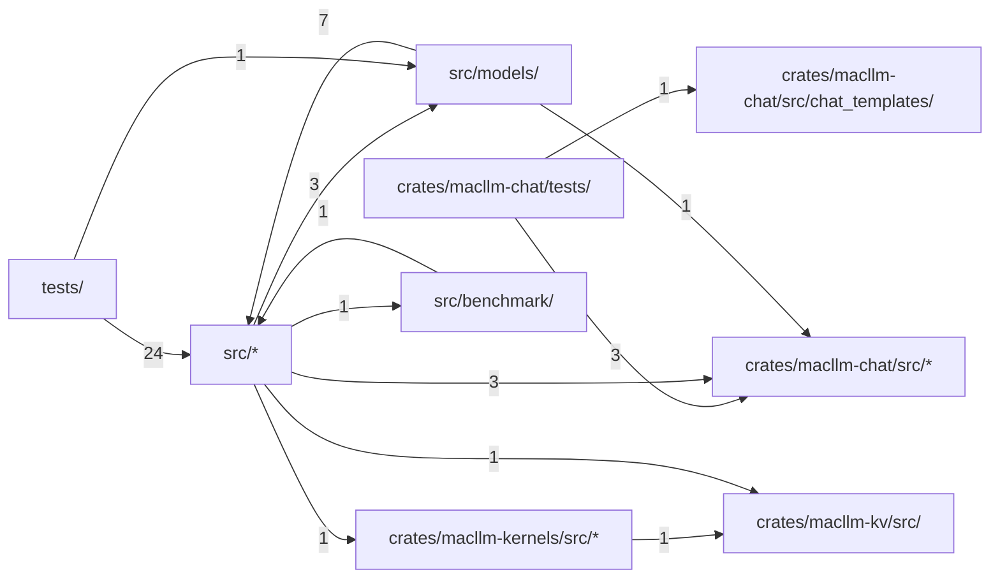

# Code structure

**English** · [中文](zh/structure.md)

Generated by Codocia from the code on every build: areas, each area's own description, import dependencies between areas, and the pages that explain them.

In scope: 120 files, 119,414 lines; excluded `tests/fixtures/**`, `Cargo.lock`, `LICENSE-MIT`, `README_CN.md`, `.gitignore`

## Files

**Repository root**

- (root files) — 388 lines, 5 files. An Apple Silicon-first Rust LLM inference runtime\
  Hub files: `build.rs`\
  Explained in: [Overview and Support Matrix](01-overview.md) (1), [How It Works](04-how-it-works.md) (1)
- `benchmarks/` — 144 lines, 3 files\
  Explained in: [Benchmarks, Gates and Contributing](05-benchmarks-and-testing.md) (2)
- `scripts/` — 25 lines, 1 file\
  Hub files: `bench-llama-cpp.sh`\
  Explained in: [Benchmarks, Gates and Contributing](05-benchmarks-and-testing.md) (1)
- `tests/` — 10,485 lines, 26 files\
  Explained in: [Benchmarks, Gates and Contributing](05-benchmarks-and-testing.md) (2)

**`crates/macllm-chat/`**

- (files) — 42 lines, 1 file. Protocol-independent chat, tool-call and constrained-output contracts for MacLLM Infer\
  Explained in: not covered
- `tests/` — 301 lines, 1 file\
  Explained in: not covered

**`crates/macllm-chat/src/`**

- (files) — 13,756 lines, 11 files. Protocol-independent chat contracts for `MacLLM Infer`.\
  Hub files: `tool_format.rs` `chat.rs` `lib.rs`\
  Explained in: [HTTP Server and API Subset](03-http-api.md) (2), [Benchmarks, Gates and Contributing](05-benchmarks-and-testing.md) (1)
- `chat_templates/` — 597 lines, 3 files. Byte-exact chat and agent prompt renderers for the pinned model families.\
  Hub files: `mod.rs` `qwen3.rs` `qwen35.rs`\
  Explained in: [Benchmarks, Gates and Contributing](05-benchmarks-and-testing.md) (1)

**`crates/macllm-kernels/`**

- (files) — 49 lines, 1 file. Paged-attention, gated-delta and Mamba2 kernels for MacLLM Infer\
  Explained in: not covered

**`crates/macllm-kernels/src/`**

- (files) — 4,284 lines, 4 files. Custom Candle kernels for `MacLLM Infer`.\
  Hub files: `lib.rs` `paged_attention.rs` `gated_delta.rs`\
  Explained in: [How It Works](04-how-it-works.md) (1)
- `metal/` — 652 lines, 3 files\
  Explained in: [How It Works](04-how-it-works.md) (1)

**`crates/macllm-kv/`**

- (files) — 42 lines, 1 file. Paged K/V cache and request-prefix index for MacLLM Infer\
  Explained in: not covered
- `src/` — 6,153 lines, 3 files. K/V cache and prefix index for `MacLLM Infer`.\
  Hub files: `cache.rs` `lib.rs` `prefix_cache.rs`\
  Explained in: [How It Works](04-how-it-works.md) (2)

**`src/`**

- (files) — 50,030 lines, 22 files. `MacLLM Infer` is an Apple Silicon-first Rust LLM inference runtime.\
  Hub files: `lib.rs` `architecture.rs` `gguf.rs`\
  Explained in: [Overview and Support Matrix](01-overview.md) (3), [Command-Line Usage](02-cli.md) (5), [HTTP Server and API Subset](03-http-api.md) (5), [How It Works](04-how-it-works.md) (7), [Benchmarks, Gates and Contributing](05-benchmarks-and-testing.md) (4)
- `benchmark/` — 23,286 lines, 20 files. Reproducible, fail-closed `MacLLM` versus `llama.cpp` scoreboard primitives.\
  Hub files: `schema.rs` `mod.rs` `prefix_demo_mac.rs`\
  Explained in: [Overview and Support Matrix](01-overview.md) (1), [Benchmarks, Gates and Contributing](05-benchmarks-and-testing.md) (3)
- `models/` — 9,180 lines, 15 files\
  Hub files: `mod.rs` `qwen3.rs` `llama.rs`\
  Explained in: [Overview and Support Matrix](01-overview.md) (1), [Command-Line Usage](02-cli.md) (2), [HTTP Server and API Subset](03-http-api.md) (2), [How It Works](04-how-it-works.md) (1), [Benchmarks, Gates and Contributing](05-benchmarks-and-testing.md) (1)

## Dependencies

A → B means files in A import B; the number counts file-level imports. Showing the strongest 13 of 13 edges.

