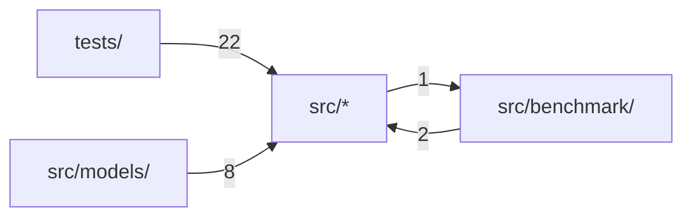

# Code structure

**English** · [中文](zh/structure.md)

Generated by Codocia from the code on every build: areas, each area's own description, import dependencies between areas, and the pages that explain them.

In scope: 96 files, 92,879 lines; excluded `tests/fixtures/**`, `Cargo.lock`, `LICENSE-MIT`, `README_CN.md`, `.gitignore`

## Files

**Repository root**

- (files) — 304 lines, 3 files. An Apple Silicon-first Rust LLM inference runtime\
  Hub files: `build.rs`\
  Explained in: [Overview and Support Matrix](01-overview.md) (1), [How It Works](04-how-it-works.md) (1)
- `benchmarks/` — 144 lines, 3 files\
  Explained in: [Benchmarks, Gates and Contributing](05-benchmarks-and-testing.md) (2)
- `scripts/` — 25 lines, 1 file\
  Hub files: `bench-llama-cpp.sh`\
  Explained in: [Benchmarks, Gates and Contributing](05-benchmarks-and-testing.md) (1)
- `tests/` — 7,137 lines, 23 files\
  Explained in: [Benchmarks, Gates and Contributing](05-benchmarks-and-testing.md) (2)

**`src/`**

- (files) — 56,303 lines, 30 files. `MacLLM Infer` is an Apple Silicon-first Rust LLM inference runtime.\
  Hub files: `lib.rs` `architecture.rs` `gguf.rs`\
  Explained in: [Overview and Support Matrix](01-overview.md) (3), [Command-Line Usage](02-cli.md) (5), [HTTP Server and API Subset](03-http-api.md) (5), [How It Works](04-how-it-works.md) (7), [Benchmarks, Gates and Contributing](05-benchmarks-and-testing.md) (4)
- `benchmark/` — 23,014 lines, 19 files. Reproducible, fail-closed `MacLLM` versus `llama.cpp` scoreboard primitives.\
  Hub files: `schema.rs` `mod.rs` `prefix_demo_mac.rs`\
  Explained in: [Overview and Support Matrix](01-overview.md) (1), [Benchmarks, Gates and Contributing](05-benchmarks-and-testing.md) (3)
- `metal/` — 652 lines, 3 files\
  Explained in: [How It Works](04-how-it-works.md) (1)
- `models/` — 5,300 lines, 14 files\
  Hub files: `qwen3.rs` `llama.rs` `qwen3_tasks.rs`\
  Explained in: [Overview and Support Matrix](01-overview.md) (1), [Command-Line Usage](02-cli.md) (1), [HTTP Server and API Subset](03-http-api.md) (1), [How It Works](04-how-it-works.md) (1), [Benchmarks, Gates and Contributing](05-benchmarks-and-testing.md) (1)

## Dependencies

A → B means files in A import B; the number counts file-level imports. Showing the strongest 4 of 4 edges.

