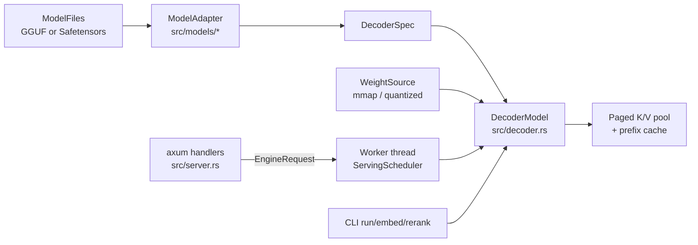

# 工作原理

[English](../04-how-it-works.md) · **中文**

每个命令都经过 `LoadedRuntime::load`：打开文件，选择 adapter，从 `WeightSource` 构建共享 decoder，然后配置 paged K/V 池、prefix cache 和 prefill attention 模式。阻塞式命令直接调用模型。`serve` 在一个 worker 线程中构建同样的运行时，该线程在整个生命周期内独占模型。

来源: [lib.rs:1-7](../../../src/lib.rs#L1-L7) · [runtime.rs:66-103](../../../src/runtime.rs#L66-L103) · [engine.rs:849-862](../../../src/engine.rs#L849-L862)

## Adapter 与共享 decoder

`ModelAdapter` 是唯一存放模型家族代码的地方。Adapter 把配置或 GGUF 元数据转换成 `RuntimeSpec` 和 `DecoderSpec`，映射权重名称，并渲染 chat 或 agent prompt。未固定的 GGUF 模板交给通用 Jinja 渲染器（Qwen adapter 在 `attach_prompt_tokens` 中处理，其余由 `with_jinja_fallback` 处理）。每个 adapter 的 `build_model` 都返回 `DecoderModel`，因此 attention、缓存、批处理和采样只需实现一次。

`DecoderSpec` 是逐层 spec 的列表。每一层选择一种 `SequenceMixerSpec`：`Attention`（full 或 sliding causal，RoPE 或 NoPE）、`ShortConvolution`（LFM2）、`GatedDeltaNet`（Qwen3.5）或 `ParallelAttentionMamba2`（Falcon-H1），再加上一个 dense 或 sparse-MoE 前馈层。混合架构模型只是不同的层列表；decoder 实现了运行时其余部分所使用的 `CausalLm` trait。

`ModelAdapter::build` 检查构建出的模型的运行时元数据与 adapter 是否一致，`validate` 在接触任何权重之前检查 spec 的一致性。

来源: [mod.rs:35-66](../../../src/models/mod.rs#L35-L66) · [mod.rs:128-155](../../../src/models/mod.rs#L128-L155) · [mod.rs:609-627](../../../src/models/mod.rs#L609-L627) · [gguf_model.rs:365-387](../../../src/gguf_model.rs#L365-L387) · [mod.rs:698-714](../../../src/models/mod.rs#L698-L714) · +7

## 零拷贝加载权重

`ModelFiles::weight_source` 通过 Candle 的 `VarBuilder` 对 Safetensors 做内存映射。GGUF 走项目自己的解析器和基于 mmap 的 `GgufWeightSource`，块量化矩阵在模型构建期间始终保持压缩，并以 `QMatMul` 运行。启用 `metal` feature 时，`file_backed_quant` 把每个 GGUF 分片的只读映射包装成一个共享的 Metal buffer，并按文件偏移绑定每个张量。而 Candle 自带的加载器会把每个权重复制到匿名 buffer 中，使整个模型都变成 dirty 的统一内存。

因此，由模型文件构建的模型存续期间，文件不得被修改或截断（加载器因此是 `unsafe` 的）；GGUF 保留已打开的文件句柄，解析后替换 GGUF 路径是安全的。加载完成后，会请求 macOS 归还构建 tokenizer 和元数据时释放的内存页（`malloc_zone_pressure_relief`）。

来源: [weights.rs:240-275](../../../src/weights.rs#L240-L275) · [file_backed_quant.rs:1-6](../../../src/file_backed_quant.rs#L1-L6) · [model_weights.rs:1-40](../../../src/model_weights.rs#L1-L40) · [model_weights.rs:305-306](../../../src/model_weights.rs#L305-L306) · [runtime.rs:118-133](../../../src/runtime.rs#L118-L133)

## 服务调度器

模型不必实现 `Send`：`EngineHandle::start` 在 `macllm-inference` 线程中构建模型，并且从不移动它。HTTP handler 通过有界通道（`--queue-capacity`）发送 `InferenceJob`，并拿回一个 `EngineTicket`，即请求本地的事件流。丢弃 ticket 就会取消该请求。

Worker 按轮执行 continuous batching。每轮最多访问 `--max-active-sequences` 个活跃序列。每个序列最多分到 `--prefill-token-quantum` 个输入 token，一轮在达到 `--scheduler-token-budget` 时结束。所有被访问的 lane 作为一次 packed ragged 前向计算执行。Decode lane 只占一个 token，因此长 prompt 不会饿死正在进行的生成。客户端在 `--event-send-timeout-seconds` 内一直不消费事件的 lane 会被取消。

panic，或者从准入、共享的 `drive_once` 步骤中逃逸出来的错误（例如模型前向计算失败），会让 worker 进入 poisoned 状态（`/healthz` 报告 `poisoned`），并使活跃和排队中的请求失败。请求本地的失败（非法采样参数、单个 lane 的 KV cache 耗尽、未完成的 JSON schema 输出）只会让该请求失败。

来源: [runtime.rs:56-59](../../../src/runtime.rs#L56-L59) · [engine.rs:829-869](../../../src/engine.rs#L829-L869) · [engine.rs:1578-1648](../../../src/engine.rs#L1578-L1648) · [engine.rs:1938-1965](../../../src/engine.rs#L1938-L1965) · [engine.rs:2003-2088](../../../src/engine.rs#L2003-L2088) · +6

## K/V cache 布局

每个 decoder 层都有一个 `KvCachePolicy`：

- `Paged`：full-attention 层共享一个全模型范围的池。池中的 block 长度为 `--kv-cache-block-tokens`，每次分配 `--kv-cache-slab-blocks` 个，总量最多 `--kv-cache-capacity-tokens`（默认是所有序列合计一个模型上下文，而不是每个序列一个）。每个序列持有一个由 block ID 组成的 `PagedKvBlockTable`，一个 block 存放所有 full-attention 层的 K 和 V。
- `Sliding`：局部 attention 层为每个序列维护一个 `2 * (W - 1)` 个槽位的环形缓冲。回滚时只需恢复三个整数，无需复制张量。
- `Full`：按需增长的连续缓存。

批次增长是事务性的。`PagedKvBatchReservation` 在前向计算之前为每个 lane 预留 block，未提交就丢弃时会全部回滚。Block 可以通过引用计数在多个表之间共享；向共享的、未填满的尾部 block 追加时会先复制它（copy-on-write）。

来源: [cache.rs:119-125](../../../crates/macllm-kv/src/cache.rs#L119-L125) · [cache.rs:165-169](../../../crates/macllm-kv/src/cache.rs#L165-L169) · [cache.rs:1432-1441](../../../crates/macllm-kv/src/cache.rs#L1432-L1441) · [cache.rs:1481-1491](../../../crates/macllm-kv/src/cache.rs#L1481-L1491) · [cache.rs:2423-2428](../../../crates/macllm-kv/src/cache.rs#L2423-L2428) · +3

## 自动 prefix cache

`TokenPrefixCache` 是一个按开销限额的 LRU，缓存模型状态快照，以精确的 token ID 为键。哈希 block 只用于缩小候选范围；每次命中都要从位置 0 开始逐 token 比较确认。快照只在每个插入的 prompt 末尾保存，而不是在每个 block 上保存，因此一组逐渐变长的 prompt 不会占用平方级的状态。

Prefill 之后，`publish_prompt_prefix` 保存 prompt。纯 attention 模型会把它截断到 block 边界，存成一个 fork 出来的 block 表，通过引用计数共享页面。处理下一个 prompt 之前，`reset_session_for_prompt` 把最长匹配恢复到会话中，并报告为 `cached_tokens`。

循环层（ShortConv、Gated DeltaNet、Mamba2）需要在精确末尾位置保存状态快照，因为循环状态无法截断。Sliding-window 环形缓冲是可变的，无法 fork，所以 `validate_prefix_cache_topology` 会拒绝任何 sliding 层。因此该缓存与 sliding-window attention 互斥，在这类模型上设置非零容量会导致加载错误，而不是静默地不生效。Benchmark 的波次可以通过 `EngineRequestPolicy` 选择不发布前缀。

来源: [prefix_cache.rs:1-7](../../../crates/macllm-kv/src/prefix_cache.rs#L1-L7) · [prefix_cache.rs:116-122](../../../crates/macllm-kv/src/prefix_cache.rs#L116-L122) · [decoder.rs:3473-3511](../../../src/decoder.rs#L3473-L3511) · [decoder.rs:3513-3552](../../../src/decoder.rs#L3513-L3552) · [decoder.rs:4320-4352](../../../src/decoder.rs#L4320-L4352) · +2

## 自定义 Metal kernel 在运行时编译

在 Candle 的运算之外，`macllm-kernels` 在 `crates/macllm-kernels/src/metal/` 中添加了三个 Metal 源文件：`paged_decode.metal`（通过 block 页表读取 K/V 的 paged attention，包括一个批量 GQA-4 变体）、`gated_delta_decay.metal`（Gated DeltaNet）和 `mamba2_scan.metal`（Mamba2 scan）。每个文件都用 `include_str!` 嵌入，在设备第一次需要时由 `new_library_with_source` 从源码编译。Pipeline 按 Metal 设备的 `registry_id` 缓存。

`build.rs` 从不处理这些 kernel；它只为 benchmark 嵌入构建信息和 Git 溯源信息。因此 kernel 编译错误会在首次使用时出现，benchmark 使用 `--warmup-runs` 把编译开销排除在测量之外。

只有预检通过时才会使用 paged kernel：batch 为 1，每个 lane 最多 128 个 query token、最多 128 个 lane，head 维度不超过 256，F32 或 F16，并且 Metal 设备支持 Tier 2 argument buffer。否则它返回 `None`，decoder 回退到先物化完整矩阵的 attention（materialized attention）。

来源: [paged_attention.rs:800](../../../crates/macllm-kernels/src/paged_attention.rs#L800) · [paged_attention.rs:1205-1236](../../../crates/macllm-kernels/src/paged_attention.rs#L1205-L1236) · [paged_attention.rs:5-55](../../../crates/macllm-kernels/src/paged_attention.rs#L5-L55) · [paged_attention.rs:892-896](../../../crates/macllm-kernels/src/paged_attention.rs#L892-L896) · [mamba2.rs:332](../../../crates/macllm-kernels/src/mamba2.rs#L332) · +10
