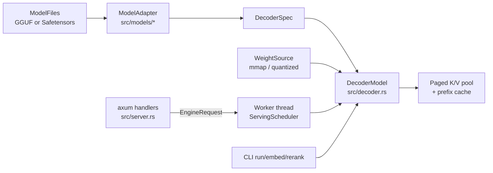
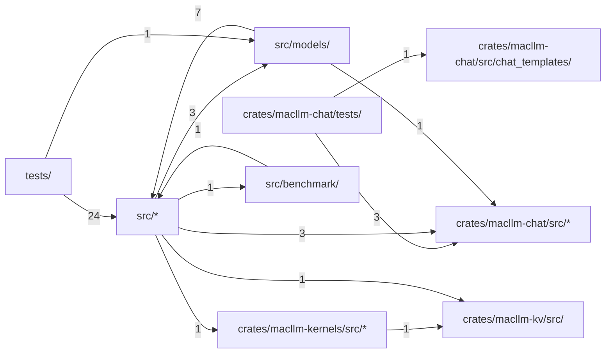

# macllm-infer

[English](../all.md) · **中文**

这套文档比 MacLLM Infer 的 README 更深入一层。MacLLM Infer 是一个用 Rust 编写、
Apple Silicon 优先的纯文本 LLM 运行时。文档说明当前提交的代码实际支持什么（哪些格式和架构、
哪些 CLI 参数和 HTTP 字段、哪些默认值），一个请求如何从模型加载开始，依次经过服务调度器、
paged K/V cache 和 prefix cache，最终到达 Metal kernel，以及固定的参考测试和 benchmark
manifest 如何为正确性和性能结论把关。文档只描述当前能力。

## 概览与支持矩阵

MacLLM Infer 是一个以 Apple Silicon 为先的 Rust workspace，通过 Candle 运行纯文本 decoder LLM。主 crate 是 `macllm-infer`（二进制为 `macllm`）；对话和工具调用处理、K/V cache 以及自定义 kernel 分别放在 `macllm-chat`、`macllm-kv` 和 `macllm-kernels` 这几个 crate 中。Metal 和 Accelerate 是默认 feature；可选的 `cuda` feature 通过 `--device cuda` 支持 NVIDIA GPU。所有支持的模型家族都由同一个共享 decoder 执行；家族相关代码仅限于很薄的 adapter，负责把 checkpoint 的配置、权重名称和 prompt 模板转换成与格式无关的 spec。同一个已加载的模型既用于阻塞式 CLI 生成、Qwen3 向量嵌入和重排序，也用于长期运行的 HTTP worker。`llama.cpp` 被用作 GGUF 解析、贪心解码 token 的正确性和性能的参考，但从不作为链接依赖。

本页准确说明代码接受什么。用法见 [命令行用法](#cli)，设计见 [工作原理](#how-it-works)，模块结构见 [代码结构](#structure)。

来源: [Cargo.toml:1-22](../../../Cargo.toml#L1-L22) · [Cargo.toml:46-71](../../../Cargo.toml#L46-L71) · [lib.rs:1-7](../../../src/lib.rs#L1-L7) · [lib.rs:40-45](../../../src/lib.rs#L40-L45) · [backend.rs:34-58](../../../src/backend.rs#L34-L58) · +1

### 支持的格式和架构

`ModelFiles::from_dir` 接受单个 `.gguf` 文件或一个目录。同时包含 GGUF 和 Safetensors 权重的目录会被拒绝；`macllm download` 标记为未下载完成的目录也会被拒绝。其他情况下发现文件时 GGUF 优先，规范的 GGUF 分片集合会作为一个逻辑文件打开。

两种格式覆盖的架构并不相同：

| 格式 | Dispatch 键 | 架构 |
| --- | --- | --- |
| GGUF v3 | `GgufModel::open` 中的 `general.architecture` | `falcon-h1`、`gemma`、`gemma2`、`gemma3`、`granitemoe`、`lfm2`、`llama`、`qwen2`、`qwen3`、`qwen3moe`、`qwen35`、`smollm3` |
| Safetensors | `config.json` 中的 `model_type`（`detect`） | `llama`、`lfm2`、`qwen2`、`qwen3` |

因此 12 种架构的列表只适用于 GGUF。Safetensors 目录还需要 `config.json` 和 `tokenizer.json`；GGUF 使用内嵌的 tokenizer。`GgufTensorType` 接受的 GGUF 张量类型为 F32、F16、BF16、Q4_0、Q5_0、Q5_1、Q8_0，以及 Q2_K 到 Q6_K。

来源: [weights.rs:58-115](../../../src/weights.rs#L58-L115) · [snapshot.rs:83-96](../../../src/snapshot.rs#L83-L96) · [mod.rs:698-714](../../../src/models/mod.rs#L698-L714) · [gguf_model.rs:316-335](../../../src/gguf_model.rs#L316-L335) · [gguf.rs:283-297](../../../src/gguf.rs#L283-L297)

### 当前限制一览

支持范围以具体 checkpoint 为边界，不满足条件时直接失败（fail closed）。新用户最先遇到的边界：

- 向量嵌入和重排序只接受 Safetensors 格式的 Qwen3 任务 checkpoint（`validate_task_checkpoint`），并且只以 `embed`/`rerank` CLI 命令的形式提供；HTTP 路由中没有向量嵌入或重排序路由。见 [命令行用法](#cli)。
- 服务暴露 `/healthz`、`/v1/models`、`/v1/chat/completions` 和一个用于 benchmark 的 `/completion` 路由。模型能做哪些工具调用取决于它的对话模板。见 [HTTP 服务与 API 子集](#http-api)。
- 自动 prefix cache 与 sliding-window attention 层互斥：在含有 sliding 层的模型上启用该缓存会在加载时失败。见 [工作原理](#how-it-works)。
- CPU 后端要求 `--dtype f32`。
- 正确性结论来自按 checkpoint 固定的参考测试，例如 Gemma 1 2B Q2_K 和 SmolLM3-3B Q4_K_M。见 [Benchmark、门禁测试与贡献](#benchmarks-and-testing)。

来源: [main.rs:1010-1023](../../../src/main.rs#L1010-L1023) · [server.rs:224-228](../../../src/server.rs#L224-L228) · [decoder.rs:4331-4352](../../../src/decoder.rs#L4331-L4352) · [backend.rs:61-71](../../../src/backend.rs#L61-L71)

## 命令行用法

`macllm` 二进制有九个子命令：`download`、`inspect`、`run`、`embed`、`rerank`、`bench`、`scoreboard`、`demo` 和 `serve`。下文所有参数都照搬自 `src/main.rs` 中的 clap 定义。运行时不读取任何环境变量；代码中的 `MACLLM_*` 变量只用于让被忽略的参考测试找到 fixture 文件（见 [Benchmark、门禁测试与贡献](#benchmarks-and-testing)）。`serve` 见 [HTTP 服务与 API 子集](#http-api)；`bench`、`scoreboard` 和 `demo` 见 [Benchmark、门禁测试与贡献](#benchmarks-and-testing)。

来源: [main.rs:62-96](../../../src/main.rs#L62-L96)

### 模型、设备和 K/V 参数

所有加载模型的命令共用 `RuntimeArgs`：

| 参数 | 默认值 | 含义 |
| --- | --- | --- |
| `-m, --model` | 必填 | `.gguf` 文件或模型目录 |
| `--device` | `metal` | `metal`、`cuda` 或 `cpu`；不带 Metal 的构建如果启用了 CUDA 则默认 `cuda`，否则默认 `cpu` |
| `--dtype` | 见下文 | 激活值使用 `f32`、`f16`、`bf16` |
| `--kv-cache-block-tokens` | `16` | 每个逻辑 K/V block 的 token 数 |
| `--kv-cache-slab-blocks` | `8` | 每次物理 slab 分配的 block 数 |
| `--kv-cache-capacity-tokens` | 一个模型上下文 | 所有序列共享的 K/V token 总数，向上取整到一个 block |
| `--prefill-attention` | `sdpa` | 多行 prefill 分块使用 Candle 的融合 SDPA kernel；`native` 保留分页 Metal kernel 及其稠密回退路径 |

`resolve_dtype` 在 CPU 上或 GGUF 含有量化张量时选择 `f32`，否则选择 `f16`。CPU/Accelerate 后端只接受 `f32`；Metal 和 CUDA 三种都接受。

来源: [main.rs:36-48](../../../src/main.rs#L36-L48) · [main.rs:114-150](../../../src/main.rs#L114-L150) · [runtime.rs:37-40](../../../src/runtime.rs#L37-L40) · [runtime.rs:167-180](../../../src/runtime.rs#L167-L180) · [backend.rs:61-71](../../../src/backend.rs#L61-L71)

### 用 run 生成文本

`run` 通过 adapter 的对话模板渲染 `--prompt`（以及可选的 `--system`），完成 tokenization 后把解码出的文本流式输出到 stdout。Adapter 逐字节渲染它固定（pin）的对话模板；GGUF 文件中内嵌的未固定模板交给通用 Jinja 渲染器；两者都没有的 checkpoint 会直接失败。`--raw-prompt` 会绕过模板，原样对 prompt 做 tokenization。`--add-special-tokens` 让 tokenizer 添加 BOS/EOS；对于本身已经包含 BOS 的模板，不要打开它。

采样默认值：`--max-new-tokens 128`、`--temperature 0.7`（0 表示贪心 argmax）、`--top-k 20`、`--top-p 0.8`、`--repetition-penalty 1.1`、`--seed 42`。

`--prefill-token-quantum` 限制每次 prefill 前向计算的 prompt token 数。不设置时，Metal 使用 128（`--dtype bf16` 除外）；CPU、CUDA 和 BF16 一次完成 prefill。生成结束后，stderr 上会输出一行指标，报告 prompt、cached 和 processed token 数、TTFT，以及 prefill 和 decode 的每秒 token 数。

来源: [main.rs:152-190](../../../src/main.rs#L152-L190) · [main.rs:1320-1334](../../../src/main.rs#L1320-L1334) · [main.rs:1345-1356](../../../src/main.rs#L1345-L1356) · [mod.rs:515-536](../../../src/models/mod.rs#L515-L536) · [gguf_model.rs:365-387](../../../src/gguf_model.rs#L365-L387) · +1

### 向量嵌入和重排序

`embed` 和 `rerank` 只支持 Safetensors 格式的 Qwen3 任务 checkpoint。`Qwen3EmbeddingProfile` 和 `Qwen3RerankerProfile` 会检查 sentence-transformers 文件（`modules.json`、`config_sentence_transformers.json`，以及 pooling 或 logit-score 模块配置）、EOS token、last-token pooling 或互不相同的 yes/no 标签 ID；随后 `validate_task_checkpoint` 要求必须是 Safetensors 格式。这些任务只能通过 CLI 使用。

- `embed --input-type query|document --input TEXT [--input TEXT ...] [--instruction TEXT]`；`--instruction` 只对 query 有效。
- `rerank --query TEXT --document TEXT [--document TEXT ...] [--instruction TEXT]`。

超过 `min(max_position_embeddings, 8192)` 个 token 的输入会被拒绝，而不是截断。输出是 stdout 上格式化后的 JSON，按输入的 `index` 排序，不回显输入。向量嵌入的每一行带有单位长度的 `embedding`；重排序的每一行带有 `margin`（`yes_logit - no_logit`）和 `yes_probability`（其 sigmoid 值）。

来源: [main.rs:216-276](../../../src/main.rs#L216-L276) · [main.rs:908-950](../../../src/main.rs#L908-L950) · [main.rs:965-1023](../../../src/main.rs#L965-L1023) · [main.rs:1025-1068](../../../src/main.rs#L1025-L1068) · [qwen3_tasks.rs:1-40](../../../src/models/qwen3_tasks.rs#L1-L40) · +5

### 下载和检查 checkpoint

`download [REPO]`（默认 `Qwen/Qwen2.5-0.5B-Instruct`，输出 `-o models/qwen2.5-0.5b-instruct`，可选 `--revision`）按固定的 Safetensors 允许列表下载：config、generation 和 tokenizer JSON，`model*.safetensors` 及其 index，以及 sentence-transformers 的附属文件。`--gguf FILENAME` 则改为下载仓库根目录下的一个 GGUF 文件；如果给的是规范的第一个分片，就下载全部分片。文件先落到临时暂存目录，必须通过 `ModelFiles::from_dir` 校验，之后才会替换目标目录。`.macllm-revision` 标记文件记录解析出的 commit 以及下载是否完成；标记为未完成的模型目录在加载时会被拒绝。

`inspect -m PATH` 只解析元数据而不加载权重，输出模型家族、层结构、每个 token 的 F16 K/V 字节数、每个序列固定的循环状态大小、最大上下文、词表、stop token ID、格式，以及各 GGUF 张量类型的数量。

来源: [main.rs:64-76](../../../src/main.rs#L64-L76) · [hub.rs:14-47](../../../src/hub.rs#L14-L47) · [hub.rs:59-109](../../../src/hub.rs#L59-L109) · [snapshot.rs:60-96](../../../src/snapshot.rs#L60-L96) · [main.rs:810-857](../../../src/main.rs#L810-L857)

## HTTP 服务与 API 子集

`macllm serve` 在一个专用 worker 线程上加载一个模型，并用 axum 通过 HTTP/1 提供服务，直到按下 Ctrl-C。它默认绑定 loopback，自身不带认证或 TLS；向量嵌入和重排序只通过 CLI 提供。

| 参数 | 默认值 | 含义 |
| --- | --- | --- |
| `--host` / `--port` | `127.0.0.1` / `8080` | 绑定地址 |
| `--served-model-name` | 模型路径的文件名 | 客户端作为 `model` 发送的 ID |
| `--queue-capacity` | `8` | 等待活跃槽位的请求数 |
| `--max-active-sequences` | `2` | 在 worker 上轮转的序列数 |
| `--scheduler-token-budget` | `256` | 每轮调度的模型输入 token 数 |
| `--prefill-token-quantum` | `128` | 每个序列每轮的 prompt token 数 |
| `--event-capacity` | `16` | 每个请求的事件通道大小 |
| `--event-send-timeout-seconds` | `30` | 客户端停止读取时取消请求 |
| `--prefix-cache-capacity-tokens` | `32768` | prefix cache 预算；`0` 表示禁用 |
| `--default-max-completion-tokens` | `128` | 未设置输出长度的对话请求的预算；必须不超过模型上下文 |
| `--disable-thinking` | 关闭 | 请求未设置时使用 `enable_thinking=false`；模板必须使用该选项 |
| `--sampling-profile` | `openai` | 未指定的采样字段：`openai`（1.0 / 1.0，无 top-k），或按 thinking 模式取模型卡推荐值的 `qwen3` / `qwen35` |
| `--reasoning-format` | `deepseek` | 以 `reasoning_content` 返回 thinking；`none` 把它留在答案中 |

共用的模型参数（`--model`、`--device`、`--dtype`、`--kv-cache-*`）与 [命令行用法](#cli) 中相同。

来源: [main.rs:440-491](../../../src/main.rs#L440-L491) · [main.rs:1357-1392](../../../src/main.rs#L1357-L1392) · [server.rs:142-170](../../../src/server.rs#L142-L170) · [server.rs:232-262](../../../src/server.rs#L232-L262)

### 端点

| 路由 | 用途 |
| --- | --- |
| `GET /healthz` | `status`、`worker`（`starting`、`ready`、`busy`、`poisoned`、`stopped`）、`model`、`device`（实际运行的后端：`metal`、`cuda` 或 `cpu`）、`dtype`；不健康时返回 503 |
| `GET /v1/models` | 唯一的服务模型 |
| `POST /v1/chat/completions` | 严格的 Chat Completions 子集，JSON 或 SSE |
| `POST /completion` | 不套模板、与 llama-server 形状一致的路由，供 benchmark 使用 |

`/completion` 要求提供 `RawCompletionRequest` 的每一个字段（`prompt`、`n_predict`、`temperature`、`top_k`、`top_p`、`seed`、`cache_prompt`、`stream`、`return_tokens`、`id_slot`、`ignore_eos`、`repeat_penalty`、`response_fields`），并拒绝未知字段，这样 benchmark 中的两个服务端遵循完全相同的约定。

队列已满时返回 429；worker 已停止或处于 poisoned 状态时返回 503。流式响应每 15 秒发送一条 keep-alive 注释，并以 `data: [DONE]` 结束。

来源: [server.rs:224-228](../../../src/server.rs#L224-L228) · [server.rs:264-299](../../../src/server.rs#L264-L299) · [engine.rs:1287-1292](../../../src/engine.rs#L1287-L1292) · [backend.rs:74-88](../../../src/backend.rs#L74-L88) · [server.rs:327-344](../../../src/server.rs#L327-L344) · +3

### /v1/chat/completions 接受哪些字段

未知 JSON 字段返回 400；已知但不支持的字段返回 OpenAI 格式的错误，而不是被丢弃。

- `model` 必须等于服务的模型名；`n` 必须为 1。
- `max_completion_tokens`（或已弃用的 `max_tokens`，两者不能同时出现）默认取 `--default-max-completion-tokens`，且不能超过模型上下文。
- `temperature`（范围 [0, 2]）和 `top_p`（范围 (0, 1]）默认取 `--sampling-profile` 的值，该 profile 也决定 `top_k`；`presence_penalty` 和 `frequency_penalty` 接受 [-2, 2]；`seed` 必须非负。重复惩罚固定为 1.0。
- `stop` 接受一个字符串或最多 4 个字符串。
- `stream` 支持 `stream_options.include_usage`；`include_obfuscation=true` 会被拒绝。
- `chat_template_kwargs` 只接受布尔值的 `enable_thinking`。
- 角色：`system`、`user`、`assistant`，以及工具调用历史中的 `tool`（字符串内容加上一个 `tool_call_id`，回应前一个 assistant 轮次中的某个调用）。该轮次只能包含一个调用；在检测到工具调用格式的通用模板上可以包含多个。assistant 的 `reasoning_content` 只对 Qwen3、Qwen3MoE 和 Qwen3.5 模型族接受，不论由哪种模板渲染。`function`、`developer`、`name`、多模态内容、`logprobs` 和 `top_logprobs` 都会被拒绝。

`usage.prompt_tokens_details.cached_tokens` 报告有多少 prompt token 来自 prefix cache。

来源: [openai.rs:54-108](../../../crates/macllm-chat/src/openai.rs#L54-L108) · [openai.rs:136-230](../../../crates/macllm-chat/src/openai.rs#L136-L230) · [openai.rs:600-630](../../../crates/macllm-chat/src/openai.rs#L600-L630) · [output.rs:4](../../../crates/macllm-chat/src/output.rs#L4) · [openai.rs:937-1035](../../../crates/macllm-chat/src/openai.rs#L937-L1035) · +6

### 结构化输出和 tool call

`crates/macllm-chat/src/grammar.rs` 中的约束 grammar 会把每个候选 token 解码后的字节与一个封闭的 JSON Schema 子集进行比对。未知的 schema 关键字会被拒绝，object schema 必须设置 `additionalProperties: false`。

- `response_format` 只接受 `{"type":"json_schema","json_schema":{...,"strict":true}}`，不能与 `stop`、工具或 tool call 历史同时使用。
- 工具：最多 128 个名称互不相同的函数。声明了工具时，`tool_choice` 默认为 `auto`；也接受 `none`、指定函数，或只声明一个工具时的 `"required"`。启用工具时不允许使用 `stop`。
- 在固定的 Qwen3、Qwen3MoE 或 Qwen3.5 模板上使用 `auto`：答案末尾可以有一个调用，由 lazy grammar 约束。在通用 GGUF 模板上，调用格式从模板中检测（Hermes、Qwen XML、Llama 3 JSON、Mistral JSON、Granite JSON、Pythonic）；每个解析出的调用都会按其声明校验；除非 `parallel_tool_calls` 允许多个，否则只返回第一个。
- 强制调用需要 `parallel_tool_calls=false`，参数在 schema 约束下生成。它适用于固定的 Qwen3/Qwen3MoE profile 和通用 Hermes 模板；Qwen3.5 会拒绝强制调用，prompt 打开了推理块的通用模板也会拒绝。
- 其他 adapter 在 `format_agent_prompt` 中直接失败（fail closed）。

来源: [grammar.rs:1-20](../../../crates/macllm-chat/src/grammar.rs#L1-L20) · [openai.rs:232-247](../../../crates/macllm-chat/src/openai.rs#L232-L247) · [openai.rs:632-650](../../../crates/macllm-chat/src/openai.rs#L632-L650) · [openai.rs:652-689](../../../crates/macllm-chat/src/openai.rs#L652-L689) · [openai.rs:691-795](../../../crates/macllm-chat/src/openai.rs#L691-L795) · +13

### 启动检查与 prefix cache 参数

`EngineHandle::start` 只有在 worker 加载完模型后才返回，因此任何一项检查失败，`serve` 都会在绑定端口之前退出：

1. 模型必须支持 packed ragged batch。
2. Adapter 必须能通过它固定的模板或通用模板渲染一个健康检查用的 chat prompt，并且该 prompt 至少要 tokenize 出一个 token。没有可用模板的 checkpoint 可以用 `run --raw-prompt` 运行，但不能提供服务。
3. 服务端级别的 `--disable-thinking` 必须被模板支持。
4. 所有 `--max-active-sequences` 个会话都会预先创建。

之后 `serve` 还会检查 `--default-max-completion-tokens` 不超过模型上下文。

`serve` 默认启用自动 prefix cache（32768 个 token），而该缓存不能与 sliding-window attention 共存（[工作原理](#how-it-works)）。因此任何含有 `SlidingCausal` 层的模型都会加载失败，报错 "sliding-attention storage is mutable"。Gemma 2 和 Gemma 3 通常会交替使用这类层，GGUF Llama 在 `llama.attention.sliding_window` 非零时也会有这类层。为这些模型提供服务时请使用 `--prefix-cache-capacity-tokens 0`。

来源: [engine.rs:863-867](../../../src/engine.rs#L863-L867) · [engine.rs:1224-1239](../../../src/engine.rs#L1224-L1239) · [engine.rs:1269-1360](../../../src/engine.rs#L1269-L1360) · [mod.rs:115-117](../../../src/models/mod.rs#L115-L117) · [server.rs:233-240](../../../src/server.rs#L233-L240) · +6

## 工作原理

每个命令都经过 `LoadedRuntime::load`：打开文件，选择 adapter，从 `WeightSource` 构建共享 decoder，然后配置 paged K/V 池、prefix cache 和 prefill attention 模式。阻塞式命令直接调用模型。`serve` 在一个 worker 线程中构建同样的运行时，该线程在整个生命周期内独占模型。

来源: [lib.rs:1-7](../../../src/lib.rs#L1-L7) · [runtime.rs:66-103](../../../src/runtime.rs#L66-L103) · [engine.rs:849-862](../../../src/engine.rs#L849-L862)

### Adapter 与共享 decoder

`ModelAdapter` 是唯一存放模型家族代码的地方。Adapter 把配置或 GGUF 元数据转换成 `RuntimeSpec` 和 `DecoderSpec`，映射权重名称，并渲染 chat 或 agent prompt。未固定的 GGUF 模板交给通用 Jinja 渲染器（Qwen3、Qwen3MoE 和 Qwen3.5 在 `attach_prompt_tokens` 中处理，其余包括 Qwen2 由 `with_jinja_fallback` 处理）。每个 adapter 的 `build_model` 都返回 `DecoderModel`，因此 attention、缓存、批处理和采样只需实现一次。

`DecoderSpec` 是逐层 spec 的列表。每一层选择一种 `SequenceMixerSpec`：`Attention`（full 或 sliding causal，RoPE 或 NoPE）、`ShortConvolution`（LFM2）、`GatedDeltaNet`（Qwen3.5）或 `ParallelAttentionMamba2`（Falcon-H1），再加上一个 dense 或 sparse-MoE 前馈层。混合架构模型只是不同的层列表；decoder 实现了运行时其余部分所使用的 `CausalLm` trait。

`ModelAdapter::build` 检查构建出的模型的运行时元数据与 adapter 是否一致，`validate` 在接触任何权重之前检查 spec 的一致性。

来源: [mod.rs:35-66](../../../src/models/mod.rs#L35-L66) · [mod.rs:128-155](../../../src/models/mod.rs#L128-L155) · [mod.rs:609-627](../../../src/models/mod.rs#L609-L627) · [gguf_model.rs:365-387](../../../src/gguf_model.rs#L365-L387) · [mod.rs:698-714](../../../src/models/mod.rs#L698-L714) · +7

### 零拷贝加载权重

`ModelFiles::weight_source` 通过 Candle 的 `VarBuilder` 对 Safetensors 做内存映射。GGUF 走项目自己的解析器和基于 mmap 的 `GgufWeightSource`，块量化矩阵在模型构建期间始终保持压缩，并以 `QMatMul` 运行。启用 `metal` feature 时，`file_backed_quant` 把每个 GGUF 分片的只读映射包装成一个共享的 Metal buffer，并按文件偏移绑定每个张量。而 Candle 自带的加载器会把每个权重复制到匿名 buffer 中，使整个模型都变成 dirty 的统一内存。

因此，由模型文件构建的模型存续期间，文件不得被修改或截断（加载器因此是 `unsafe` 的）；GGUF 保留已打开的文件句柄，解析后替换 GGUF 路径是安全的。加载完成后，会请求 macOS 归还构建 tokenizer 和元数据时释放的内存页（`malloc_zone_pressure_relief`）。

来源: [weights.rs:240-275](../../../src/weights.rs#L240-L275) · [file_backed_quant.rs:1-6](../../../src/file_backed_quant.rs#L1-L6) · [model_weights.rs:1-40](../../../src/model_weights.rs#L1-L40) · [model_weights.rs:305-306](../../../src/model_weights.rs#L305-L306) · [runtime.rs:118-133](../../../src/runtime.rs#L118-L133)

### 服务调度器

模型不必实现 `Send`：`EngineHandle::start` 在 `macllm-inference` 线程中构建模型，并且从不移动它。HTTP handler 通过有界通道（`--queue-capacity`）发送 `InferenceJob`，并拿回一个 `EngineTicket`，即请求本地的事件流。丢弃 ticket 就会取消该请求。

Worker 按轮执行 continuous batching。每轮最多访问 `--max-active-sequences` 个活跃序列。每个序列最多分到 `--prefill-token-quantum` 个输入 token，一轮在达到 `--scheduler-token-budget` 时结束。所有被访问的 lane 作为一次 packed ragged 前向计算执行。Decode lane 只占一个 token，因此长 prompt 不会饿死正在进行的生成。客户端在 `--event-send-timeout-seconds` 内一直不消费事件的 lane 会被取消。

panic，或者从准入、共享的 `drive_once` 步骤中逃逸出来的错误（例如模型前向计算失败），会让 worker 进入 poisoned 状态（`/healthz` 报告 `poisoned`），并使活跃和排队中的请求失败。请求本地的失败（非法采样参数、单个 lane 的 KV cache 耗尽、未完成的 JSON schema 输出）只会让该请求失败。

来源: [runtime.rs:56-59](../../../src/runtime.rs#L56-L59) · [engine.rs:829-869](../../../src/engine.rs#L829-L869) · [engine.rs:1578-1648](../../../src/engine.rs#L1578-L1648) · [engine.rs:1938-1965](../../../src/engine.rs#L1938-L1965) · [engine.rs:2003-2088](../../../src/engine.rs#L2003-L2088) · +6

### K/V cache 布局

每个 decoder 层都有一个 `KvCachePolicy`：

- `Paged`：full-attention 层共享一个全模型范围的池。池中的 block 长度为 `--kv-cache-block-tokens`，每次分配 `--kv-cache-slab-blocks` 个，总量最多 `--kv-cache-capacity-tokens`（默认是所有序列合计一个模型上下文，而不是每个序列一个）。每个序列持有一个由 block ID 组成的 `PagedKvBlockTable`，一个 block 存放所有 full-attention 层的 K 和 V。
- `Sliding`：局部 attention 层为每个序列维护一个 `2 * (W - 1)` 个槽位的环形缓冲。回滚时只需恢复三个整数，无需复制张量。
- `Full`：按需增长的连续缓存。

批次增长是事务性的。`PagedKvBatchReservation` 在前向计算之前为每个 lane 预留 block，未提交就丢弃时会全部回滚。Block 可以通过引用计数在多个表之间共享；向共享的、未填满的尾部 block 追加时会先复制它（copy-on-write）。

来源: [cache.rs:119-125](../../../crates/macllm-kv/src/cache.rs#L119-L125) · [cache.rs:165-169](../../../crates/macllm-kv/src/cache.rs#L165-L169) · [cache.rs:1432-1441](../../../crates/macllm-kv/src/cache.rs#L1432-L1441) · [cache.rs:1481-1491](../../../crates/macllm-kv/src/cache.rs#L1481-L1491) · [cache.rs:2423-2428](../../../crates/macllm-kv/src/cache.rs#L2423-L2428) · +3

### 自动 prefix cache

`TokenPrefixCache` 是一个按开销限额的 LRU，缓存模型状态快照，以精确的 token ID 为键。哈希 block 只用于缩小候选范围；每次命中都要从位置 0 开始逐 token 比较确认。快照只在每个插入的 prompt 末尾保存，而不是在每个 block 上保存，因此一组逐渐变长的 prompt 不会占用平方级的状态。

Prefill 之后，`publish_prompt_prefix` 保存 prompt。纯 attention 模型会把它截断到 block 边界，存成一个 fork 出来的 block 表，通过引用计数共享页面。处理下一个 prompt 之前，`reset_session_for_prompt` 把最长匹配恢复到会话中，并报告为 `cached_tokens`。

循环层（ShortConv、Gated DeltaNet、Mamba2）需要在精确末尾位置保存状态快照，因为循环状态无法截断。Sliding-window 环形缓冲是可变的，无法 fork，所以 `validate_prefix_cache_topology` 会拒绝任何 sliding 层。因此该缓存与 sliding-window attention 互斥，在这类模型上设置非零容量会导致加载错误，而不是静默地不生效。Benchmark 的波次可以通过 `EngineRequestPolicy` 选择不发布前缀。

来源: [prefix_cache.rs:1-7](../../../crates/macllm-kv/src/prefix_cache.rs#L1-L7) · [prefix_cache.rs:116-122](../../../crates/macllm-kv/src/prefix_cache.rs#L116-L122) · [decoder.rs:3473-3511](../../../src/decoder.rs#L3473-L3511) · [decoder.rs:3513-3552](../../../src/decoder.rs#L3513-L3552) · [decoder.rs:4320-4352](../../../src/decoder.rs#L4320-L4352) · +2

### 自定义 Metal kernel 在运行时编译

在 Candle 的运算之外，`macllm-kernels` 在 `crates/macllm-kernels/src/metal/` 中添加了三个 Metal 源文件：`paged_decode.metal`（通过 block 页表读取 K/V 的 paged attention，包括一个批量 GQA-4 变体）、`gated_delta_decay.metal`（Gated DeltaNet）和 `mamba2_scan.metal`（Mamba2 scan）。每个文件都用 `include_str!` 嵌入，在设备第一次需要时由 `new_library_with_source` 从源码编译。Pipeline 按 Metal 设备的 `registry_id` 缓存。

`build.rs` 从不处理这些 kernel；它只为 benchmark 嵌入构建信息和 Git 溯源信息。因此 kernel 编译错误会在首次使用时出现，benchmark 使用 `--warmup-runs` 把编译开销排除在测量之外。

只有预检通过时才会使用 paged kernel：batch 为 1，每个 lane 最多 128 个 query token、最多 128 个 lane，head 维度不超过 256，F32 或 F16，并且 Metal 设备支持 Tier 2 argument buffer。否则它返回 `None`，decoder 回退到先物化完整矩阵的 attention（materialized attention）。

来源: [paged_attention.rs:800](../../../crates/macllm-kernels/src/paged_attention.rs#L800) · [paged_attention.rs:1205-1236](../../../crates/macllm-kernels/src/paged_attention.rs#L1205-L1236) · [paged_attention.rs:5-55](../../../crates/macllm-kernels/src/paged_attention.rs#L5-L55) · [paged_attention.rs:892-896](../../../crates/macllm-kernels/src/paged_attention.rs#L892-L896) · [mamba2.rs:332](../../../crates/macllm-kernels/src/mamba2.rs#L332) · +10

## Benchmark、门禁测试与贡献

本项目的结论建立在两类证据之上。按 checkpoint 固定的参考测试证明 token 级别的正确性，对照对象是 `llama.cpp` 或 Candle。`macllm scoreboard`、`macllm demo` 和 `macllm bench` 下按 manifest 固定的 benchmark 衡量性能。所有测量命令都拒绝在未优化的构建中运行（`ensure_optimized_measurement_execution`），所以请使用 `--release`。

来源: [mod.rs:1](../../../src/benchmark/mod.rs#L1) · [gemma_gguf_reference.rs:1-8](../../../tests/gemma_gguf_reference.rs#L1-L8) · [main.rs:763-808](../../../src/main.rs#L763-L808)

### 固定的参考门禁测试

真实模型测试标记为 `#[ignore]`，需要对应的 fixture 文件。Gemma 1 的门禁测试很有代表性：它按大小和 SHA-256 固定公开文件，并检查 prompt token ID。在 CPU 和 Metal 上，它都断言带缓存的 decode 与全新的完整前向计算一致（argmax 相同，logit 的最大差值和相对 RMS 在界限内），并且贪心生成能复现 `llama.cpp` 的 token ID。其他门禁测试则与 `llama.cpp` 的 golden 输出、Candle 的独立实现之一或两者进行比较。

| 架构 | 固定的 fixture |
| --- | --- |
| `gemma` | Gemma 1 2B-it Q2_K（`tensorblock/gemma-2b-it-GGUF`） |
| `gemma2` / `gemma3` | Gemma 2 2B-it Q4_K_M / Gemma 3 270M-it QAT Q4_0 |
| `smollm3` | SmolLM3-3B Q4_K_M（官方） |
| `llama` | SmolLM2-135M、Llama 3.2 1B Q4_K_M、TinyLlama Q2_K 和 Q3_K_M、TinyMistral-6x248M MoE |
| `qwen2` / `qwen3` / `qwen35` | Qwen2.5-0.5B Q4_0 / Qwen3-0.6B Q8_0（也有 12 分片版本）和 Qwen3-4B Q4_K_M / Qwen3.5-0.8B Q4_0 |
| `qwen3moe` / `granitemoe` | loggenix-moe Q8_0 / Granite 3.1 1B-A400M Q4_K_M |
| `lfm2` / `falcon-h1` | LFM2-350M Q4_K_M / Falcon-H1-Tiny-90M Q8_0 |
| 任务 | Qwen3 Embedding 和 Reranker checkpoint，对照 Candle 和 Qwen 的示例 |

运行某个门禁测试时需设置其 fixture 变量，例如 `MACLLM_GEMMA_GGUF_MODEL=models/gemma-2b-it-q2_k cargo test --release --test gemma_gguf_reference -- --ignored --nocapture`。

来源: [gemma_gguf_reference.rs:1-8](../../../tests/gemma_gguf_reference.rs#L1-L8) · [gemma_gguf_reference.rs:27-54](../../../tests/gemma_gguf_reference.rs#L27-L54) · [gemma_gguf_reference.rs:148-201](../../../tests/gemma_gguf_reference.rs#L148-L201) · [gemma_gguf_reference.rs:290-312](../../../tests/gemma_gguf_reference.rs#L290-L312) · [smollm3_gguf_reference.rs:1-8](../../../tests/smollm3_gguf_reference.rs#L1-L8) · +17

### Scoreboard manifest

Scoreboard manifest（`schema_version` 1，见 `benchmarks/manifests/`）固定六类信息：`host`（机器型号、芯片、内存、CPU 架构）；`model`（相对于 manifest 的路径、Hugging Face 仓库、revision、文件名、大小、SHA-256、架构、量化方式）；`llama_cpp`（二进制目录、build 号、commit、GPU 层数、flash attention、K/V cache 类型、mmap）；`workload`（prompt 文件及其 SHA-256、token 数和 token ID 的 SHA-256、decode 步数、贪心采样、并发宽度 1/4/8、预热次数、样本数、prefix cache 模式）；以及 `runtime`（设备、dtype、prefill quantum、K/V 设置）。

`scoreboard verify --manifest PATH` 不加载权重。它检查主机、模型字节、检测出的架构、是否为单个 GGUF 文件、prompt token ID，以及 `llama-server`/`llama-bench` 二进制的 commit，然后输出 JSON 摘要。任何不匹配都会导致失败。各个测量子命令都会先运行 `verify`：`macllm-kernel`、`llama-bench`、`llama-server`（`--port`，默认 18081）、`macllm-serving`，以及 `report`，后者运行所有阶段并写出 `--json` 和 `--markdown`。

来源: [main.rs:348-394](../../../src/main.rs#L348-L394) · [runner.rs:72-175](../../../src/benchmark/runner.rs#L72-L175) · [smollm3-3b-q4_k_m-m4pro.json](../../../benchmarks/manifests/smollm3-3b-q4_k_m-m4pro.json) · [main.rs:716-761](../../../src/main.rs#L716-L761)

### Prefix cache 演示与本地 bench

`demo prefix-cache` 和 `demo fair-prefix` 把一个仓库的 `Cargo.toml` 和 `src/**/*.rs`（`--repository`，默认 `.`）转换成精确的 16K token 共享前缀，并以八个并发请求发送给两个运行时。它们默认使用端口 18085 和 18086，分别写出 `prefix-cache-demo.{json,md}` 或 `fair-prefix-benchmark.{json,md}`。结果只是该主机上该次运行的 点估计（point estimate）。

`fair-prefix` 还要求两边使用相同的 HTTP transport 和 F32 K/V 精度。`main.rs` 把 `MAC_PREFIX_DEMO_DEFAULT_MEASURED_WAVES`（20）作为每个实现的测量波次数传入。`validate_inputs` 要求至少 20 个波次，且波次数能平均分配到 4 个相互平衡（counterbalanced）的进程生命周期中，同时 manifest 中的 `fair_prefix` 块必须完全匹配。该块必须声明每个生命周期 5 个预热波次（`FAIR_WARMUP_WAVES_PER_LIFETIME`）、32 token 的输出、已预热的 prefix cache，以及等于波次数乘以 8（160）的 `samples_per_concurrency`。一个 3 波次的稳态窗口（`FAIR_STEADY_STATE_WINDOW_WAVES`）用于检查预热。

`bench generate|embed|rerank` 是不需要 manifest 的本地诊断工具：在 `--warmup-runs`（默认 1）之后进行 `--runs`（默认 20）次测量，使用贪心解码，并拒绝任何输出发生漂移的运行。`scripts/bench-llama-cpp.sh MODEL.gguf` 运行原生的 `llama-bench`，并读取 `PROMPT_TOKENS`（512）、`OUTPUT_TOKENS`（128）和 `RUNS`（3）。

来源: [main.rs:396-438](../../../src/main.rs#L396-L438) · [main.rs:660-673](../../../src/main.rs#L660-L673) · [prefix_demo_mac.rs:39-46](../../../src/benchmark/prefix_demo_mac.rs#L39-L46) · [fair_prefix.rs:59-61](../../../src/benchmark/fair_prefix.rs#L59-L61) · [fair_prefix.rs:912-956](../../../src/benchmark/fair_prefix.rs#L912-L956) · +5

### 添加模型家族

新增一个模型家族只需改动它的 adapter 和一个 dispatch 分支。Adapter 的边界见 [工作原理](#how-it-works)，格式 dispatch 见 [概览与支持矩阵](#overview)。

1. 添加实现 `ModelAdapter` 的 `src/models/<family>.rs`：`family`、`runtime_spec`、`decoder_spec`、`build_model`（通常是 `DecoderModel::load`，张量名称不标准时用 `load_with_weight_names`）和 `format_chat_messages`。
2. 对于 GGUF，添加一个带有明确的可接受元数据键列表的 `<family>_spec` 构建器，并在 `GgufModel::open` 和 `GgufModel::architecture_adapter` 中添加 match 分支。对于 Safetensors，在 `detect` 中添加一个 `model_type` 分支。
3. 按精确身份固定（pin）已知的对话模板：`crates/macllm-chat/src/chat_templates/` 中的 Qwen3 分类器只按字节长度和 SHA-256 匹配。未固定的 GGUF 模板会回退到通用 Jinja 渲染器（[工作原理](#how-it-works)）。只有在验证过 native tool 模板之后才实现 `agent_template_profile`。
4. 在 `tests/` 下添加一个被忽略的门禁测试，按 SHA-256 固定一个公开 fixture，并与 `llama.cpp` 比较贪心 token。

如果新的层类型需要自己的 mixer，就扩展 `SequenceMixerSpec` 和 decoder，并说明 prefix cache 能否为它保存快照。

来源: [gguf_model.rs:64-83](../../../src/gguf_model.rs#L64-L83) · [gguf_model.rs:391-435](../../../src/gguf_model.rs#L391-L435) · [qwen3.rs:42-67](../../../crates/macllm-chat/src/chat_templates/qwen3.rs#L42-L67) · [mod.rs:76-80](../../../src/models/mod.rs#L76-L80) · [qwen3.rs:223-228](../../../src/models/qwen3.rs#L223-L228) · +2

## 代码结构

本页由 Codocia 根据代码自动生成，每次 build 重新计算：功能区划分、各区自带的说明、区之间的 import 依赖，以及讲解各区的页面。

范围内共 120 个文件，119,414 行；已排除 `tests/fixtures/**`、`Cargo.lock`、`LICENSE-MIT`、`README_CN.md`、`.gitignore`

### 文件结构

**仓库根目录**

- （根目录文件） — 388 行，5 个文件。An Apple Silicon-first Rust LLM inference runtime\
  核心文件：`build.rs`\
  讲解：[概览与支持矩阵](#overview) (1), [工作原理](#how-it-works) (1)
- `benchmarks/` — 144 行，3 个文件\
  讲解：[Benchmark、门禁测试与贡献](#benchmarks-and-testing) (2)
- `scripts/` — 25 行，1 个文件\
  核心文件：`bench-llama-cpp.sh`\
  讲解：[Benchmark、门禁测试与贡献](#benchmarks-and-testing) (1)
- `tests/` — 10,485 行，26 个文件\
  讲解：[Benchmark、门禁测试与贡献](#benchmarks-and-testing) (2)

**`crates/macllm-chat/`**

- （直接文件） — 42 行，1 个文件。Protocol-independent chat, tool-call and constrained-output contracts for MacLLM Infer\
  讲解：未讲解
- `tests/` — 301 行，1 个文件\
  讲解：未讲解

**`crates/macllm-chat/src/`**

- （直接文件） — 13,756 行，11 个文件。Protocol-independent chat contracts for `MacLLM Infer`.\
  核心文件：`tool_format.rs` `chat.rs` `lib.rs`\
  讲解：[HTTP 服务与 API 子集](#http-api) (2), [Benchmark、门禁测试与贡献](#benchmarks-and-testing) (1)
- `chat_templates/` — 597 行，3 个文件。Byte-exact chat and agent prompt renderers for the pinned model families.\
  核心文件：`mod.rs` `qwen3.rs` `qwen35.rs`\
  讲解：[Benchmark、门禁测试与贡献](#benchmarks-and-testing) (1)

**`crates/macllm-kernels/`**

- （直接文件） — 49 行，1 个文件。Paged-attention, gated-delta and Mamba2 kernels for MacLLM Infer\
  讲解：未讲解

**`crates/macllm-kernels/src/`**

- （直接文件） — 4,284 行，4 个文件。Custom Candle kernels for `MacLLM Infer`.\
  核心文件：`lib.rs` `paged_attention.rs` `gated_delta.rs`\
  讲解：[工作原理](#how-it-works) (1)
- `metal/` — 652 行，3 个文件\
  讲解：[工作原理](#how-it-works) (1)

**`crates/macllm-kv/`**

- （直接文件） — 42 行，1 个文件。Paged K/V cache and request-prefix index for MacLLM Infer\
  讲解：未讲解
- `src/` — 6,153 行，3 个文件。K/V cache and prefix index for `MacLLM Infer`.\
  核心文件：`cache.rs` `lib.rs` `prefix_cache.rs`\
  讲解：[工作原理](#how-it-works) (2)

**`src/`**

- （直接文件） — 50,030 行，22 个文件。`MacLLM Infer` is an Apple Silicon-first Rust LLM inference runtime.\
  核心文件：`lib.rs` `architecture.rs` `gguf.rs`\
  讲解：[概览与支持矩阵](#overview) (3), [命令行用法](#cli) (5), [HTTP 服务与 API 子集](#http-api) (5), [工作原理](#how-it-works) (7), [Benchmark、门禁测试与贡献](#benchmarks-and-testing) (4)
- `benchmark/` — 23,286 行，20 个文件。Reproducible, fail-closed `MacLLM` versus `llama.cpp` scoreboard primitives.\
  核心文件：`schema.rs` `mod.rs` `prefix_demo_mac.rs`\
  讲解：[概览与支持矩阵](#overview) (1), [Benchmark、门禁测试与贡献](#benchmarks-and-testing) (3)
- `models/` — 9,180 行，15 个文件\
  核心文件：`mod.rs` `qwen3.rs` `llama.rs`\
  讲解：[概览与支持矩阵](#overview) (1), [命令行用法](#cli) (2), [HTTP 服务与 API 子集](#http-api) (2), [工作原理](#how-it-works) (1), [Benchmark、门禁测试与贡献](#benchmarks-and-testing) (1)

### 依赖结构

箭头 A → B 表示 A 中有文件 import 了 B，数字是这样的文件级 import 数。只画最强的 13 条（共 13 条）。

