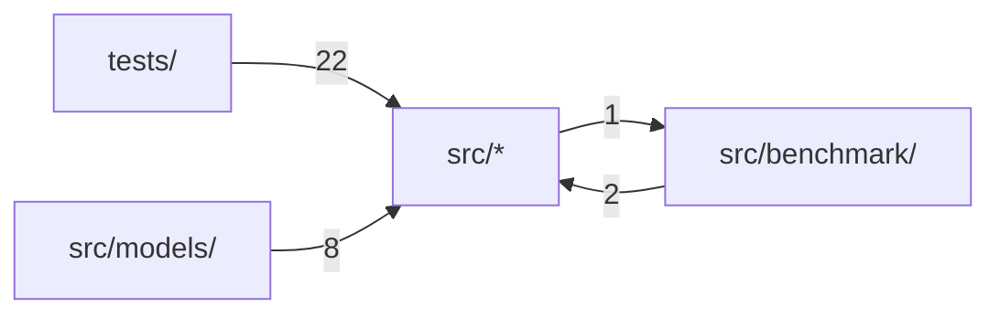

# 代码结构

[English](../structure.md) · **中文**

本页由 Codocia 根据代码自动生成，每次 build 重新计算：功能区划分、各区自带的说明、区之间的 import 依赖，以及讲解各区的页面。

范围内共 96 个文件，92,879 行；已排除 `tests/fixtures/**`、`Cargo.lock`、`LICENSE-MIT`、`README_CN.md`、`.gitignore`

## 文件结构

**仓库根目录**

- （根目录文件） — 304 行，3 个文件。An Apple Silicon-first Rust LLM inference runtime\
  核心文件：`build.rs`\
  讲解：[概览与支持矩阵](01-overview.md) (1), [工作原理](04-how-it-works.md) (1)
- `benchmarks/` — 144 行，3 个文件\
  讲解：[Benchmark、门禁测试与贡献](05-benchmarks-and-testing.md) (2)
- `scripts/` — 25 行，1 个文件\
  核心文件：`bench-llama-cpp.sh`\
  讲解：[Benchmark、门禁测试与贡献](05-benchmarks-and-testing.md) (1)
- `tests/` — 7,137 行，23 个文件\
  讲解：[Benchmark、门禁测试与贡献](05-benchmarks-and-testing.md) (2)

**`src/`**

- （直接文件） — 56,303 行，30 个文件。`MacLLM Infer` is an Apple Silicon-first Rust LLM inference runtime.\
  核心文件：`lib.rs` `architecture.rs` `gguf.rs`\
  讲解：[概览与支持矩阵](01-overview.md) (3), [命令行用法](02-cli.md) (5), [HTTP 服务与 API 子集](03-http-api.md) (5), [工作原理](04-how-it-works.md) (7), [Benchmark、门禁测试与贡献](05-benchmarks-and-testing.md) (4)
- `benchmark/` — 23,014 行，19 个文件。Reproducible, fail-closed `MacLLM` versus `llama.cpp` scoreboard primitives.\
  核心文件：`schema.rs` `mod.rs` `prefix_demo_mac.rs`\
  讲解：[概览与支持矩阵](01-overview.md) (1), [Benchmark、门禁测试与贡献](05-benchmarks-and-testing.md) (3)
- `metal/` — 652 行，3 个文件\
  讲解：[工作原理](04-how-it-works.md) (1)
- `models/` — 5,300 行，14 个文件\
  核心文件：`qwen3.rs` `llama.rs` `qwen3_tasks.rs`\
  讲解：[概览与支持矩阵](01-overview.md) (1), [命令行用法](02-cli.md) (1), [HTTP 服务与 API 子集](03-http-api.md) (1), [工作原理](04-how-it-works.md) (1), [Benchmark、门禁测试与贡献](05-benchmarks-and-testing.md) (1)

## 依赖结构

箭头 A → B 表示 A 中有文件 import 了 B，数字是这样的文件级 import 数。只画最强的 4 条（共 4 条）。

