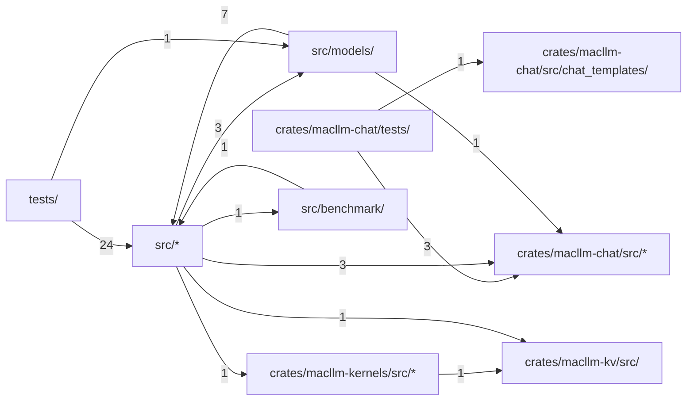

# 代码结构

[English](../structure.md) · **中文**

本页由 Codocia 根据代码自动生成，每次 build 重新计算：功能区划分、各区自带的说明、区之间的 import 依赖，以及讲解各区的页面。

范围内共 120 个文件，119,405 行；已排除 `tests/fixtures/**`、`Cargo.lock`、`LICENSE-MIT`、`README_CN.md`、`.gitignore`

## 文件结构

**仓库根目录**

- （根目录文件） — 379 行，5 个文件。An Apple Silicon-first Rust LLM inference runtime\
  核心文件：`build.rs`\
  讲解：[概览与支持矩阵](01-overview.md) (1), [工作原理](04-how-it-works.md) (1)
- `benchmarks/` — 144 行，3 个文件\
  讲解：[Benchmark、门禁测试与贡献](05-benchmarks-and-testing.md) (2)
- `scripts/` — 25 行，1 个文件\
  核心文件：`bench-llama-cpp.sh`\
  讲解：[Benchmark、门禁测试与贡献](05-benchmarks-and-testing.md) (1)
- `tests/` — 10,485 行，26 个文件\
  讲解：[Benchmark、门禁测试与贡献](05-benchmarks-and-testing.md) (2)

**`crates/macllm-chat/`**

- （直接文件） — 42 行，1 个文件。Protocol-independent chat, tool-call and constrained-output contracts for MacLLM Infer\
  讲解：未讲解
- `tests/` — 301 行，1 个文件\
  讲解：未讲解

**`crates/macllm-chat/src/`**

- （直接文件） — 13,756 行，11 个文件。Protocol-independent chat contracts for `MacLLM Infer`.\
  核心文件：`tool_format.rs` `chat.rs` `lib.rs`\
  讲解：[HTTP 服务与 API 子集](03-http-api.md) (2), [Benchmark、门禁测试与贡献](05-benchmarks-and-testing.md) (1)
- `chat_templates/` — 597 行，3 个文件。Byte-exact chat and agent prompt renderers for the pinned model families.\
  核心文件：`mod.rs` `qwen3.rs` `qwen35.rs`\
  讲解：[Benchmark、门禁测试与贡献](05-benchmarks-and-testing.md) (1)

**`crates/macllm-kernels/`**

- （直接文件） — 49 行，1 个文件。Paged-attention, gated-delta and Mamba2 kernels for MacLLM Infer\
  讲解：未讲解

**`crates/macllm-kernels/src/`**

- （直接文件） — 4,284 行，4 个文件。Custom Candle kernels for `MacLLM Infer`.\
  核心文件：`lib.rs` `paged_attention.rs` `gated_delta.rs`\
  讲解：[工作原理](04-how-it-works.md) (1)
- `metal/` — 652 行，3 个文件\
  讲解：[工作原理](04-how-it-works.md) (1)

**`crates/macllm-kv/`**

- （直接文件） — 42 行，1 个文件。Paged K/V cache and request-prefix index for MacLLM Infer\
  讲解：未讲解
- `src/` — 6,153 行，3 个文件。K/V cache and prefix index for `MacLLM Infer`.\
  核心文件：`cache.rs` `lib.rs` `prefix_cache.rs`\
  讲解：[工作原理](04-how-it-works.md) (2)

**`src/`**

- （直接文件） — 50,030 行，22 个文件。`MacLLM Infer` is an Apple Silicon-first Rust LLM inference runtime.\
  核心文件：`lib.rs` `architecture.rs` `gguf.rs`\
  讲解：[概览与支持矩阵](01-overview.md) (3), [命令行用法](02-cli.md) (5), [HTTP 服务与 API 子集](03-http-api.md) (5), [工作原理](04-how-it-works.md) (7), [Benchmark、门禁测试与贡献](05-benchmarks-and-testing.md) (4)
- `benchmark/` — 23,286 行，20 个文件。Reproducible, fail-closed `MacLLM` versus `llama.cpp` scoreboard primitives.\
  核心文件：`schema.rs` `mod.rs` `prefix_demo_mac.rs`\
  讲解：[概览与支持矩阵](01-overview.md) (1), [Benchmark、门禁测试与贡献](05-benchmarks-and-testing.md) (3)
- `models/` — 9,180 行，15 个文件\
  核心文件：`mod.rs` `qwen3.rs` `llama.rs`\
  讲解：[概览与支持矩阵](01-overview.md) (1), [命令行用法](02-cli.md) (2), [HTTP 服务与 API 子集](03-http-api.md) (2), [工作原理](04-how-it-works.md) (1), [Benchmark、门禁测试与贡献](05-benchmarks-and-testing.md) (1)

## 依赖结构

箭头 A → B 表示 A 中有文件 import 了 B，数字是这样的文件级 import 数。只画最强的 13 条（共 13 条）。

